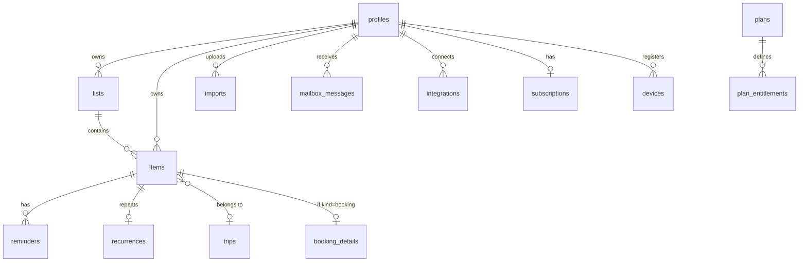

# Mô hình dữ liệu

> TL;DR: Postgres (server) và Drift/SQLite (client) dùng cùng tên bảng/cột.
> Khái niệm trung tâm: `items` (todo, nhắc, lịch hẹn), `trips` gom `items` loại booking,
> `reminders` là các lần báo cho 1 item, `recurrences` là quy tắc lặp. Quota đếm trên `items`.

## 1. Sơ đồ quan hệ



## 2. Phân loại item

| `kind` | Ví dụ | Tính vào quota |
|---|---|---|
| `task` | Mua sữa, nộp báo cáo | Không tính lịch hẹn, có tính nhắc/ngày nếu có reminder |
| `event` | Họp 15h, sinh nhật | Lịch hẹn |
| `appointment` | Khám răng, lịch khám bệnh viện | Lịch hẹn |
| `booking` | Vé máy bay, tàu, xe, khách sạn, thuê xe, tour | Lịch hẹn (mỗi segment 1 item) |
| `habit` | Uống nước, tập thể dục | Nhắc lặp lại |

`booking_type`: `flight`, `train`, `bus`, `hotel`, `car_rental`, `ferry`, `tour`, `restaurant`, `event_ticket`, `other`.

## 3. DDL rút gọn (Postgres)

```sql
create table profiles (
  id uuid primary key references auth.users on delete cascade,
  display_name text, locale text default 'vi-VN', home_tz text default 'Asia/Ho_Chi_Minh',
  inbound_email_token text unique,            -- u-<token>@in.remindme.app
  calendar_feed_token text unique,            -- webcal ICS feed
  settings jsonb not null default '{}',       -- giờ yên lặng, snooze mặc định, âm lịch bật/tắt
  created_at timestamptz default now()
);

create table lists (
  id uuid primary key, user_id uuid not null references profiles,
  name text not null, color text, icon text, sort_order int, is_inbox bool default false,
  updated_at timestamptz not null, version bigint not null, deleted_at timestamptz
);

create table items (
  id uuid primary key, user_id uuid not null references profiles,
  list_id uuid references lists, trip_id uuid references trips,
  kind text not null check (kind in ('task','event','appointment','booking','habit')),
  title text not null, notes text,
  status text not null default 'open' check (status in ('open','done','cancelled','archived','pending_quota')),
  priority smallint default 0,                -- 0 none, 1 low, 2 med, 3 high
  starts_at timestamptz, ends_at timestamptz, all_day bool default false,
  tz text,                                    -- IANA tz của sự kiện (vd giờ sân bay đi)
  end_tz text,                                -- tz điểm đến (chuyến bay)
  location jsonb,                             -- {name, address, lat, lng, place_id}
  tags text[] default '{}',
  source text default 'manual',               -- manual|voice|image|pdf|xlsx|md|email|gmail|gcal|notion|ics|pkpass
  source_ref text,                            -- id ngoài (gcal event id, message-id email) để dedupe
  import_id uuid references imports,
  checklist jsonb,                            -- [{text, done}]
  completed_at timestamptz,
  updated_at timestamptz not null, version bigint not null, deleted_at timestamptz, device_id text
);
create index on items (user_id, version);
create index on items (user_id, starts_at) where deleted_at is null;
create unique index on items (user_id, source, source_ref) where source_ref is not null and deleted_at is null;

create table recurrences (
  item_id uuid primary key references items on delete cascade, user_id uuid not null,
  kind text not null check (kind in ('rrule','lunar')),
  rrule text,                                 -- 'FREQ=WEEKLY;BYDAY=MO,WE,FR'
  lunar jsonb,                                -- {month: 7, day: 15, leap: 'skip'|'both'|'first'}
  dtstart timestamptz not null, until timestamptz, exdates timestamptz[] default '{}',
  updated_at timestamptz not null, version bigint not null, deleted_at timestamptz
);

create table reminders (
  id uuid primary key, user_id uuid not null, item_id uuid not null references items on delete cascade,
  trigger_kind text not null check (trigger_kind in ('absolute','offset','location')),
  at timestamptz,                             -- absolute
  offset_minutes int,                         -- âm = trước starts_at (vd -120 = 2h trước)
  channel text[] default '{push}',            -- push|alarm|email|watch
  is_alarm bool default false,                -- kêu kiểu báo thức (full-screen) nếu OS cho phép
  snoozed_until timestamptz,
  updated_at timestamptz not null, version bigint not null, deleted_at timestamptz
);

create table trips (
  id uuid primary key, user_id uuid not null,
  title text not null, destination text, starts_on date, ends_on date, cover_url text,
  updated_at timestamptz not null, version bigint not null, deleted_at timestamptz
);

create table booking_details (
  item_id uuid primary key references items on delete cascade, user_id uuid not null,
  booking_type text not null, provider text,  -- 'Vietnam Airlines', 'VNR', 'Agoda'
  confirmation_code text,                      -- PNR / mã đặt phòng
  carrier_code text, number text,              -- VN, 245
  origin jsonb, destination jsonb,             -- {code:'SGN', name, terminal, gate, tz}
  seat text, class text, passengers jsonb,     -- [{name, ticket_no}]  (mã hóa cột, xem security-privacy)
  check_in_at timestamptz, check_out_at timestamptz,
  price jsonb,                                 -- {amount, currency}
  extraction_meta jsonb,                       -- {template_id, field_confidence} (không lưu ảnh/text gốc)
  updated_at timestamptz not null, version bigint not null
);

create table imports (
  id uuid primary key, user_id uuid not null,
  -- Metadata của 1 lần import (xử lý trên máy; đồng bộ lên để dedupe đa thiết bị và thống kê)
  kind text not null,                          -- image|pdf|xlsx|md|email|voice|text|ics|pkpass
  sha256 text, mime text, bytes int,
  status text not null default 'reviewing',    -- reviewing|committed|discarded|failed
  doc_type text, template_id text, template_version int,
  tier_used text,                              -- t0|t1t2|t3_apple|t3_gemini|t4
  original_path text,                          -- chỉ khi Plus bật "Giữ bản gốc"
  error text, created_at timestamptz default now(),
  updated_at timestamptz not null, version bigint not null
);
-- import_candidates chỉ có ở client (Drift): đề xuất chưa duyệt không cần lên server.

create table mailbox_messages (               -- email forward chờ máy tải về
  id uuid primary key, user_id uuid not null, storage_path text not null, bytes int,
  from_addr text, spf_dkim_pass bool, received_at timestamptz default now(),
  fetched_at timestamptz, expires_at timestamptz not null   -- TTL 7 ngày
);

create table integrations (
  id uuid primary key, user_id uuid not null,
  provider text not null,                      -- google|microsoft|notion
  scopes text[], external_account text,
  token_ref text not null,                     -- khóa trong Supabase Vault, không lưu token thô
  sync_state jsonb, status text default 'active', updated_at timestamptz
);

create table devices (
  id text primary key, user_id uuid not null, platform text, fcm_token text,
  app_version text, os_version text, tz text, oem text, last_seen_at timestamptz
);

-- Thanh toán & quota
create table plans (id text primary key, name text, period text, store_product_ids jsonb);
create table plan_entitlements (
  plan_id text references plans, key text, value int,  -- -1 = không giới hạn
  primary key (plan_id, key)
);
create table subscriptions (
  user_id uuid primary key, plan_id text references plans, status text,  -- active|grace|billing_retry|expired
  store text, original_transaction_id text, current_period_end timestamptz, updated_at timestamptz
);
create table usage_counters (
  user_id uuid, key text, period_start date, value int default 0,
  primary key (user_id, key, period_start)
);
```

## 4. Quy tắc đếm quota (thực thi trong RPC `sync_push` và trigger)
| Key | Cách đếm |
|---|---|
| `max_reminders_per_day` | Số thông báo dự kiến kêu trong 1 ngày lịch (theo `home_tz`), gồm cả các lần lặp. Kiểm tra khi tạo/sửa reminder: mở rộng 7 ngày tới, lấy ngày nhiều nhất |
| `max_recurring_series` | Số `recurrences` chưa xóa, item chưa `done/archived` |
| `max_active_appointments` | Số item `kind in (event, appointment, booking)`, `status='open'`, `ends_at`/`starts_at` >= now() - 1 ngày |
| `max_active_trips` | Số trip có `ends_on >= today` |
| `smart_imports_per_month` | Đếm trên máy (`usage_counters` local, đồng bộ lên) khi import ảnh/pdf/xlsx/email tới màn Xem lại. Import `.ics`, `.pkpass`, `.md`, boarding pass barcode không tính. Chỉ là giới hạn sản phẩm, không bảo vệ chi phí |
| `max_originals_mb` | Tổng dung lượng bản gốc đã lưu (Plus) |

Giá trị cụ thể: `docs/product/pricing-entitlements.md`.

## 5. Bảng chỉ có ở client (Drift)
- `outbox(id, table, row_id, op, payload, created_at, attempts)`: hàng đợi đẩy lên server.
- `scheduled_notifications(notification_id, reminder_id, occurrence_at, os_request_id)`: những gì đã đăng ký với OS.
- `entitlement_cache(key, value, fetched_at)`.
- `import_candidates(id, import_id, payload, field_confidence, evidence, accepted)`.
- `template_store(id, version, json, signature)` + `column_mappings(header_hash, mapping)` (mục 4.5 của `on-device-extraction.md`).
- `sync_state(table, last_version)`.
