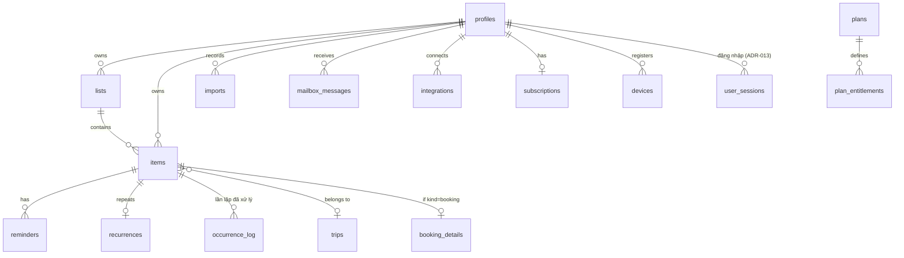

# Mô hình dữ liệu

> TL;DR: Postgres (server) và Drift/SQLite (client) dùng cùng tên bảng/cột. Khái niệm trung tâm: `items` (todo, nhắc, lịch hẹn),
> `trips` gom các `items` loại booking, `reminders` là các mốc báo của 1 item, `recurrences` là quy tắc lặp (RRULE hoặc hệ lịch khác).
> **Đường ghi duy nhất là RPC `sync_push`** (ADR-012), nơi kiểm quota. Quy tắc quota ở mục 4, giá trị ở `docs/product/pricing-entitlements.md`.

## 1. Sơ đồ quan hệ


## 2. Phân loại item
| `kind` | Ví dụ | Tính vào quota |
|---|---|---|
| `task` | Mua sữa, nộp báo cáo | Chỉ tính `max_reminders_per_day` nếu có reminder |
| `event` | Họp 15h, sinh nhật | Lịch hẹn |
| `appointment` | Khám răng, lịch khám bệnh viện | Lịch hẹn |
| `booking` | Vé máy bay, tàu, xe, khách sạn, thuê xe, tour | Lịch hẹn (mỗi segment 1 item) |
| `habit` | Uống nước, tập thể dục | Chuỗi lặp |

`booking_type`: `flight`, `train`, `bus`, `hotel`, `car_rental`, `ferry`, `tour`, `restaurant`, `event_ticket`, `other`.
`status`: `open`, `done`, `cancelled`, `archived`, `pending_quota` (tạo khi offline, chờ server xác nhận quota; bị từ chối thì thành `archived` kèm `archived_reason='quota'`).

## 3. DDL rút gọn (Postgres)
**Cột đồng bộ chuẩn** (gọi tắt `SYNC_COLS`, có ở mọi bảng đồng bộ: lists, items, recurrences, reminders, trips, booking_details, imports, occurrence_log):
`updated_at timestamptz not null, version bigint not null` (server gán từ sequence), `deleted_at timestamptz` (tombstone),
`device_id text` (thiết bị sửa cuối), `field_clock jsonb` (HLC theo từng trường, cho Last-Writer-Wins theo trường).
Mọi khóa `user_id` đều `references profiles on delete cascade` (xóa tài khoản xóa sạch dữ liệu).
`field_clock` là HLC dạng chuỗi so được theo thứ tự byte: `'<epoch_ms 13 chữ số>:<counter 4 chữ số>:<device_id>'`; trường có clock lớn hơn thắng.
**SQL thực thi:** `supabase/migrations/` (test `supabase/tests/database/`). So với bản rút gọn dưới đây, migration có thêm: khóa ngoại tới list/trip/import/item
kèm `user_id` (không trỏ được sang dữ liệu người khác), CHECK đầy đủ, `version` do trigger gán sau khóa advisory theo user (sync_pull không sót hàng).
`profile_init` tạo list Inbox với id xác định `md5(user_id || ':inbox')::uuid` để máy offline tự tính ra cùng id; tên Inbox hiển thị lấy từ ARB.

```sql
create table profiles (
  id uuid primary key references auth.users on delete cascade,
  display_name text,
  ui_locale text not null,                    -- lấy từ máy lúc onboarding, ví dụ 'en-GB', 'vi-VN'
  region text not null,                       -- ISO 3166 'GB', 'VN': định dạng, ngày lễ, cuối tuần
  home_tz text not null,                      -- IANA, lấy từ máy
  voice_locales text[] default '{}',          -- ['vi-VN','en-US'] (chính + phụ)
  calendar_systems text[] default '{}',       -- hệ lịch phụ đang bật: 'lunar_vi'|'lunar_zh'|'lunar_ko'|'hijri'
  inbound_email_token text unique,            -- u-<token>@in.remindme.app
  calendar_feed_token text unique,            -- feed ICS (Plus)
  settings jsonb not null default '{}',       -- giờ yên lặng, snooze mặc định, thiết bị nhận nhắc...
  created_at timestamptz default now()
);

create table lists (
  id uuid primary key, user_id uuid not null references profiles on delete cascade,
  name text not null, color text, icon text, sort_order int, is_inbox bool default false,
  SYNC_COLS
);

create table items (
  id uuid primary key, user_id uuid not null references profiles on delete cascade,
  list_id uuid references lists, trip_id uuid references trips,
  kind text not null check (kind in ('task','event','appointment','booking','habit')),
  title text not null, notes text,
  status text not null default 'open'
    check (status in ('open','done','cancelled','archived','pending_quota')),
  archived_reason text,                       -- 'past'|'user'|'quota'
  priority smallint default 0,                -- 0 none, 1 low, 2 med, 3 high
  starts_at timestamptz, ends_at timestamptz,
  all_day bool default false, start_date date, end_date date,   -- item cả ngày dùng date, không dùng timestamptz
  tz text,                                    -- IANA của sự kiện (giờ sân bay đi)
  end_tz text,                                -- IANA điểm đến (chuyến bay)
  time_mode text default 'fixed' check (time_mode in ('fixed','floating')),  -- xem reminder-engine §5
  location jsonb,                             -- {name, address, lat, lng, place_id}
  tags text[] default '{}',
  source text default 'manual',               -- manual|voice|image|pdf|xlsx|md|email|gmail|gcal|gtasks|notion|mstodo|ics|pkpass
  source_ref text,                            -- id ngoài (gcal event id, Message-ID, sha256 file) để dedupe
  import_id uuid references imports,
  checklist jsonb,                            -- [{text, done}]
  completed_at timestamptz,
  SYNC_COLS
);
create index on items (user_id, version);
create index on items (user_id, starts_at) where deleted_at is null;
create unique index on items (user_id, source, source_ref) where source_ref is not null and deleted_at is null;

create table recurrences (
  item_id uuid primary key references items on delete cascade,
  user_id uuid not null references profiles on delete cascade,
  kind text not null check (kind in ('rrule','calendar','after_completion')),
  rrule text,                                 -- kind=rrule: 'FREQ=WEEKLY;BYDAY=MO,WE,FR'
  calendar jsonb,                             -- kind=calendar: {system:'lunar_vi'|'lunar_zh'|'lunar_ko'|'hijri', month?, day, leap?:'skip'|'both'}  -- month null = hằng tháng (rằm)
  interval_days int,                          -- kind=after_completion: lặp N ngày sau lần hoàn thành trước
  workdays_region text,                       -- 'ngày làm việc' theo cuối tuần + ngày lễ của quốc gia này
  dtstart timestamptz not null, until timestamptz, exdates timestamptz[] default '{}',
  SYNC_COLS
);

create table occurrence_log (                 -- trạng thái từng lần của chuỗi lặp
  item_id uuid references items on delete cascade, user_id uuid not null references profiles on delete cascade,
  occurrence_at timestamptz, status text check (status in ('done','skipped','snoozed')),
  primary key (item_id, occurrence_at), SYNC_COLS
);

create table reminders (
  id uuid primary key, user_id uuid not null references profiles on delete cascade,
  item_id uuid not null references items on delete cascade,
  trigger_kind text not null check (trigger_kind in ('absolute','offset','location')),
  at timestamptz,                             -- absolute
  offset_minutes int,                         -- âm = trước starts_at (-120 = 2h trước)
  geofence jsonb,                             -- location (Phase 2): {lat, lng, radius_m, on:'enter'|'exit'}
  channel text[] default '{push}',            -- push|alarm|watch; 'email' Phase 3
  is_alarm bool default false,
  snoozed_until timestamptz,
  SYNC_COLS
);

create table trips (
  id uuid primary key, user_id uuid not null references profiles on delete cascade,
  title text not null, destination text, starts_on date, ends_on date, cover_url text,
  packing jsonb,                              -- checklist hành lý [{id, text, done, group}], LWW cả mảng (migration 10)
  SYNC_COLS
);

create table booking_details (
  item_id uuid primary key references items on delete cascade,
  user_id uuid not null references profiles on delete cascade,
  booking_type text not null, provider text,  -- 'Vietnam Airlines', 'Deutsche Bahn', 'Agoda'
  confirmation_code text,                     -- PNR / mã đặt phòng
  carrier_code text, number text,             -- VN, 245
  origin jsonb, destination jsonb,            -- {code:'SGN', name, terminal, gate, tz}
  seat text, class text, passengers jsonb,    -- [{name, ticket_no}] (mã hóa cột, xem security-privacy)
  check_in_at timestamptz, check_out_at timestamptz,
  price jsonb,                                -- {amount, currency} theo đồng tiền gốc
  extraction_meta jsonb,                      -- {template_id, field_confidence} (không lưu ảnh/text gốc)
  SYNC_COLS
);

create table imports (                        -- metadata 1 lần import (xử lý trên máy, đồng bộ để dedupe đa thiết bị và thống kê)
  id uuid primary key, user_id uuid not null references profiles on delete cascade,
  kind text not null,                         -- image|pdf|xlsx|md|email|voice|text|ics|pkpass
  sha256 text, mime text, bytes int,
  status text not null default 'reviewing',   -- reviewing|committed|discarded|failed
  doc_type text, doc_language text, template_id text, template_version int,
  tier_used text,                             -- t0|t1t2|t3_apple|t3_gemini|t4
  original_path text,                         -- chỉ khi Plus bật "Giữ bản gốc"
  error text, created_at timestamptz default now(),
  SYNC_COLS
);

create table mailbox_messages (               -- email forward chờ máy tải về (không đồng bộ, không SYNC_COLS)
  id uuid primary key, user_id uuid not null references profiles on delete cascade,
  storage_path text not null, bytes int, from_addr text, spf_dkim_pass bool,
  received_at timestamptz default now(), fetched_at timestamptz, expires_at timestamptz not null
);

create table integrations (                   -- chỉ tích hợp có token phía server; Gmail chạy trên máy nên không có ở đây
  id uuid primary key, user_id uuid not null references profiles on delete cascade,
  provider text not null check (provider in ('google_calendar','google_tasks','microsoft','notion')),
  scopes text[], external_account text,
  token_ref text not null,                    -- khóa trong Supabase Vault, không lưu token thô
  sync_state jsonb, status text default 'active', updated_at timestamptz
);

create table devices (
  id text primary key, user_id uuid not null references profiles on delete cascade,
  platform text, fcm_token text, app_version text, os_version text, tz text, oem text, locale text,
  scheduled_until timestamptz,                -- mốc xa nhất đã lập lịch local (để server biết khi nào cần push "reschedule")
  receives_reminders bool default true,       -- người dùng chọn thiết bị nhận nhắc (reminder-engine §8)
  last_seen_at timestamptz
);

create table user_sessions (                  -- phiên đăng nhập + lịch sử (ADR-013), không đồng bộ qua sync_push
  id uuid primary key,                        -- = claim session_id trong JWT Supabase
  user_id uuid not null references profiles on delete cascade,
  device_id text not null, platform text, device_class text, device_model text,  -- device_class: phone|tablet|computer os_version text, app_version text, locale text, tz text,
  ip inet, country text,                      -- IP xóa sau 90 ngày; country từ header CDN
  status text not null default 'active',      -- active|ended; số phiên active ≤ entitlement max_active_devices
  created_at timestamptz default now(),       -- thời điểm đăng nhập
  last_seen_at timestamptz, ended_at timestamptz,
  end_reason text,                            -- replaced|same_device_relogin|signed_out|revoked_by_user|plan_limit
  replaced_by uuid references user_sessions, revoke_notified_at timestamptz
);

-- Gói & quota
create table plans (id text primary key, name text);          -- 'free', 'plus' (cấp quyền lợi, không theo kỳ)
create table plan_products (                                  -- kỳ thanh toán của 1 gói
  plan_id text references plans, period text check (period in ('P1M','P3M','P1Y')),
  store text check (store in ('app_store','play','web')), product_id text, primary key (store, product_id)
);
create table plan_entitlements (
  plan_id text references plans, key text, value int,         -- -1 = không giới hạn; feature dạng cấp: 0/1/2
  primary key (plan_id, key)
);
create table subscriptions (
  user_id uuid primary key references profiles on delete cascade, plan_id text references plans,
  status text check (status in ('trial','active','cancelled','grace','billing_retry','paused','expired','refunded')),
  -- cancelled = đã tắt gia hạn nhưng còn hạn; paused = Play pause
  period text, store text, original_transaction_id text, current_period_end timestamptz, updated_at timestamptz
);
create table usage_counters (
  user_id uuid references profiles on delete cascade, key text, period_start date, value int default 0,
  primary key (user_id, key, period_start)
);
```

## 4. Quy tắc đếm quota (thực thi trong RPC `sync_push`, hàm `app.usage_for`)
Chỉ chặn khi mức dùng sau thay đổi **vượt giới hạn và tăng so với trước** (hạ gói không khóa dữ liệu cũ). Vượt với item `pending_quota` (hoặc con của nó)
thì item thành `archived` + `archived_reason='quota'`; vượt ở trường hợp khác thì mutation bị hoàn tác và trả `quota_exceeded` kèm `{key, limit, used}`.
Chuyến mới (chưa từng lên server) bị `quota_exceeded`: `SyncEngine` bỏ chuyến ở máy, gỡ `trip_id` khỏi item của nó và gửi lại các mutation
bị lỗi khóa ngoại (`23503`) trong cùng lần sync, nên đặt chỗ, nhắc, `booking_details` vẫn lên server; lỗi của chuyến giữ trong `sync_issues` cho paywall.
| Key | Cách đếm |
|---|---|
| `max_reminders_per_day` | Số thông báo dự kiến kêu trong 1 ngày theo `home_tz`, gồm cả lần lặp. Kiểm khi tạo/sửa reminder, recurrence, item: mở rộng 7 ngày tới, lấy ngày nhiều nhất. Đổi `home_tz` không tính lại nhắc cũ. Server tính xấp xỉ để chống lách (`app.rrule_fires_on`: DAILY/WEEKLY/MONTHLY/YEARLY, BYDAY, BYMONTHDAY, BYHOUR×BYMINUTE; bỏ qua hệ lịch và `after_completion`); engine trên máy chặn chính xác |
| `max_recurring_series` | Số `recurrences` chưa xóa, item chưa `done`/`archived` |
| `max_active_appointments` | Số item `kind in (event, appointment, booking)`, `status in ('open','pending_quota')`, chưa qua (`coalesce(ends_at, starts_at, end_date)` ≥ hôm nay). Item đã qua tự `archived_reason='past'`, không tính |
| `max_active_trips` | Số trip có `ends_on >= today` hoặc chưa có `ends_on` |
| `max_lists` | Số list chưa xóa, **không tính Inbox** |
| `smart_imports_per_month` | Đếm từ bảng `imports` (đồng bộ lên): `kind in (image, pdf, xlsx, email)`, `status <> 'failed'`, trong tháng theo `home_tz`, tính cả bản ghi đã xóa. Không tính `.ics`, `.pkpass`, `.md`, boarding pass. Sửa `failed` → `committed` cũng bị kiểm |
| `max_originals_mb` | Tổng dung lượng bản gốc đã lưu trên cloud |
| `max_active_devices`, `max_devices_per_class` | Số `user_sessions` `active` (tổng và theo `device_class`); kiểm trong `session_claim` và trigger trên `subscriptions` (hạ gói). Vượt thì giữ phiên mới + phiên `last_seen_at` gần nhất, kết thúc phần còn lại (không chặn thiết bị mới) |

## 5. Bảng chỉ có ở client (Drift)
- `outbox(id, table, row_id, op, payload, field_clock, created_at, attempts)`: hàng đợi gửi `sync_push`.
- `sync_state(table, last_version)`.
- `scheduled_notifications(notification_id, reminder_id, occurrence_at, locale, os_request_id)`: những gì đã đăng ký với OS.
- `entitlement_cache(key, value, fetched_at)`, `usage_counters_local(key, period_start, value)`.
- `import_candidates(id, import_id, payload, field_confidence, evidence, accepted)`.
- `local_files(id, item_id, trip_id, kind, path, sha256, bytes)`: ảnh vé, PDF, QR lưu trên máy (tab Tài liệu của chuyến đi).
- `template_store(id, version, json, signature)`, `column_mappings(header_hash, mapping)`, `nlu_packs(lang, version)`, `holiday_packs(region, version)`.

Ánh xạ kiểu sang Drift: `uuid`/`text` → TEXT · `timestamptz` → INTEGER (epoch ms UTC) · `date` → TEXT `YYYY-MM-DD` ·
`jsonb`/`text[]`/`timestamptz[]` → TEXT (JSON) · `bool` → INTEGER 0/1.
