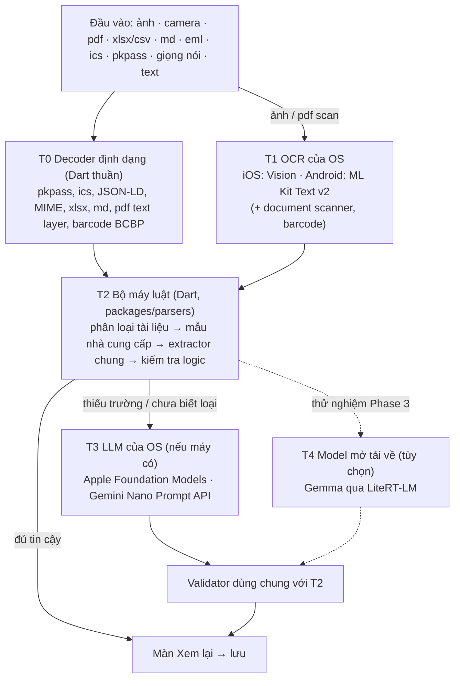

# Trích xuất trên thiết bị: ảnh, pdf, xlsx, md, email, giọng nói → todo / lịch trình

> TL;DR: **Không gọi AI API trả phí.** Mọi việc đọc file chạy trên máy người dùng bằng code (decoder, OCR của OS/ML Kit,
> luật + mẫu theo nhà cung cấp). LLM có sẵn trong OS (Apple Foundation Models, Gemini Nano) chỉ là lớp **tùy chọn** khi máy hỗ trợ.
> Spam import chỉ tốn pin máy của chính người spam, không tốn tiền server. Kết quả luôn qua màn Xem lại.
> Thay cho bản thiết kế cũ dùng Claude API (ADR-004 → ADR-010).
> Persona: *AI Engineer*, *PDF Engine Architect*, *Voice AI Integration Engineer*, *Mobile App Builder* (Agency).

## 1. Kiến trúc 5 tầng



| Tầng | Chạy ở đâu | Chi phí server | Máy hỗ trợ | Vai trò |
|---|---|---|---|---|
| T0 Decoder | Dart isolate | 0 | 100% | Định dạng có cấu trúc: chính xác gần như tuyệt đối |
| T1 OCR | Native (Vision / ML Kit) | 0 | 100% (iOS 16+, Android 7+) | Ảnh/PDF scan thành chữ + tọa độ |
| T2 Luật + mẫu | Dart isolate | 0 (mẫu tải từ CDN tĩnh) | 100% | **Nguồn độ chính xác chính.** Phải tự đứng vững không cần T3 |
| T3 LLM của OS | Native | 0 | Thiểu số: iPhone có Apple Intelligence; Android flagship có Gemini Nano | Lấp trường thiếu, phân loại tài liệu lạ |
| T4 Model tải về | Native (LiteRT-LM) | 0 (CDN tải model 1 lần) | Máy RAM ≥ 8 GB, người dùng đồng ý tải | Thử nghiệm, chỉ làm nếu eval chứng minh lợi ích |

## 2. T0: Decoder định dạng (Dart thuần, `packages/parsers`)
| Định dạng | Thư viện / cách làm | Lấy được gì |
|---|---|---|
| `.pkpass` (Apple Wallet) | `archive` giải zip, đọc `pass.json` | boardingPass/eventTicket: giờ, cổng, ghế, mã vạch, relevantDate |
| `.ics` | Parser iCalendar tự viết (~300 dòng) hoặc package | VEVENT/VTODO, RRULE, VALARM |
| Email `.eml` / MIME | `enough_mail` (MIME), `html` (DOM) | Text, HTML, file đính kèm (pdf, ics, pkpass, ảnh) |
| JSON-LD / Microdata trong HTML email | Tìm `<script type="application/ld+json">`, map schema.org `FlightReservation`, `LodgingReservation`, `TrainReservation`, `BusReservation`, `EventReservation`, `FoodEstablishmentReservation` | Gần như đủ trường. Các OTA quốc tế (Booking.com, Agoda, Trip.com...) hay nhúng; hãng nội địa VN cần kiểm tra mẫu thật |
| PDF có text layer | `pdfrx` (PDFium) lấy text + tọa độ từng ký tự | Text có bố cục, dùng chung bộ máy T2 như OCR |
| PDF scan | Render trang → ảnh (`pdfrx`) → T1 | |
| xlsx / csv | `excel`, `csv` | Bảng → mục 6 |
| Markdown | `markdown` + regex Obsidian Tasks | Mục 7 |
| Barcode boarding pass | ML Kit Barcode (Android/iOS, offline) hoặc Vision `DetectBarcodesRequest`; parser **IATA BCBP (Resolution 792)** | Tên, PNR, sân bay đi/đến, hãng, số chuyến, ngày (Julian), hạng, ghế. Chính xác 100% nếu quét được |
| QR khác | Phân loại theo tiền tố: URL (mở/đọc tham số booking id), VietQR (bỏ qua: là mã thanh toán), text | |

## 3. T1: OCR trên thiết bị
| Nền tảng | Engine | Ghi chú |
|---|---|---|
| Android | **ML Kit Text Recognition v2, Latin** (tiếng Việt nằm trong danh sách "supported") | Dùng bản unbundled (qua Google Play services) để app nhẹ; fallback bundled cho máy không có GMS (Huawei) |
| iOS | **Vision** `RecognizeTextRequest` (mức `.accurate`), iOS 26+ thêm `RecognizeDocumentsRequest` (nhận bảng, đoạn, danh sách) | Tiếng Việt **chưa xác minh** trong `supportedRecognitionLanguages`. Kiểm tra trên máy thật ở Phase 0; nếu không có, dùng ML Kit trên iOS |
| Chụp giấy | Android: **ML Kit Document Scanner** (tự cắt, chỉnh nghiêng). iOS: **VisionKit** `VNDocumentCameraViewController` | Giấy hẹn khám, vé giấy |

- Thiết kế interface `OcrEngine` trả `OcrDocument{pages[{blocks[{lines[{text, bbox, conf}]}]}]}` để thay engine không đổi T2.
- Tiền xử lý: thu ảnh về cạnh dài 2000px, xoay theo EXIF; ảnh chụp màn hình giữ nguyên độ phân giải.
- Hậu xử lý tiếng Việt: chuẩn hóa Unicode NFC; so khớp từ khóa theo dạng **bỏ dấu + chữ thường** và khoảng cách Levenshtein ≤ 1
  ("Gio khoi hanh" vẫn khớp "Giờ khởi hành") để chịu lỗi OCR mất dấu.
- Tất cả chạy trong isolate/background thread, UI hiện tiến trình.

## 4. T2: Bộ máy luật (trái tim của hệ thống)
### 4.1 Phân loại tài liệu
Chấm điểm theo từ khóa có trọng số (file `classifier_weights.json`, dev huấn luyện offline bằng script từ bộ mẫu, app chỉ cộng điểm):
| Loại | Tín hiệu mạnh |
|---|---|
| `flight` | "chuyến bay", "boarding pass", "thẻ lên tàu bay", "PNR", "mã đặt chỗ", cặp mã IATA (SGN, HAN, DAD...), mã hãng + số (VN245, VJ123) |
| `train` | "tàu", "toa", "ga", mã tàu SE/TN/SP/SNT, "giường", "khoang", "Đường sắt" |
| `bus` | "xe khách", "nhà xe", "bến xe", "điểm đón", "ghế/giường số", "limousine" |
| `hotel` | "nhận phòng", "trả phòng", "check-in", "check-out", "đêm", "loại phòng", "khách sạn", "resort" |
| `medical` | "bệnh viện", "phòng khám", "phiếu hẹn", "tái khám", "số thứ tự", "BS.", "khoa", "nhịn ăn" |
| `event` | "vé", "suất chiếu", "sự kiện", "khu vực", "cổng vào" |
| `todo_list` | Nhiều dòng dạng gạch đầu dòng/ô vuông, cột ngày/việc |

### 4.2 Mẫu theo nhà cung cấp (provider templates)
Mẫu dạng JSON khai báo, không phải code, nên **cập nhật qua CDN mà không cần phát hành app**:
```jsonc
{
  "id": "vietjet.eticket.v2", "doc_type": "flight", "version": 3,
  "match": { "any_text": ["VIETJET", "VJ\\d{2,4}"], "sender_domains": ["vietjetair.com"], "min_score": 2 },
  "fields": {
    "confirmation_code": { "anchors": ["Mã đặt chỗ", "Reservation code", "Booking code"], "dir": "right|below", "pattern": "[A-Z0-9]{6}" },
    "flight_number":     { "pattern": "\\bVJ\\s?\\d{2,4}\\b" },
    "departure_date":    { "anchors": ["Ngày bay", "Date"], "dir": "right|below", "type": "date_vi" },
    "departure_time":    { "anchors": ["Giờ khởi hành", "Departure"], "dir": "right|below", "type": "time" },
    "origin":            { "type": "iata", "nth": 1 },
    "destination":       { "type": "iata", "nth": 2 },
    "passengers":        { "anchors": ["Hành khách", "Passenger"], "dir": "below", "repeat": true, "type": "person_name" }
  },
  "repeat_block": { "start": ["Chuyến đi", "Chuyến về", "Flight"], "as": "segments" }
}
```
- Engine đọc mẫu: tìm anchor (so khớp mờ), lấy vùng bên phải/bên dưới theo bbox, áp `pattern`/`type`, chấm confidence.
- Kho mẫu: `packages/parsers/templates/*.json` + test fixtures. Ký số (Ed25519) khi phát hành lên CDN; app chỉ nhận mẫu có chữ ký hợp lệ.
- Danh sách ưu tiên cho MVP (cần mẫu thật để xác nhận định dạng):
  - Bay: Vietnam Airlines, Vietjet Air, Bamboo Airways, Vietravel Airlines, Sun PhuQuoc Airways
  - OTA: Traveloka, Agoda, Booking.com, Trip.com
  - Tàu/xe: Đường sắt Việt Nam (dsvn), FUTA Phương Trang, Vexere
  - Khám bệnh: Medpro, YouMed, phiếu hẹn chung của bệnh viện công (mẫu giấy)
  - Sự kiện: Ticketbox
  - Boarding pass bất kỳ hãng nào: barcode BCBP

### 4.3 Extractor chung (khi không khớp mẫu nào)
| Trường | Cách làm |
|---|---|
| Ngày/giờ | Parser tiếng Việt/Anh dùng chung với Quick Add: `20/12/2026`, `20-12`, `Thứ Hai, 20 tháng 12`, `20 Th12`, `Dec 20, 2026`, `10:30`, `10h30`, `10g30`, khoảng `14:00 - 15:30` |
| Sân bay | Từ điển IATA (OurAirports: toàn bộ sân bay VN + ~500 sân bay quốc tế phổ biến) + tên thành phố có/không dấu → tz |
| Số chuyến bay | `\b(VN|VJ|QH|VU|9G|BL|...)\s?\d{2,4}\b` (danh sách mã hãng IATA) |
| PNR | 6 ký tự `[A-Z0-9]` gần anchor "mã đặt chỗ/PNR/booking"; loại từ tiếng Anh thường gặp |
| Ghế/toa | `\b\d{1,2}[A-K]\b`, "Toa \d+", "Ghế|Giường \d+" |
| Mã tàu | `\b(SE|TN|SP|SNT|SPT|SQN)\d{1,2}\b` |
| Địa chỉ, SĐT | Regex VN (tỉnh/thành, quận/huyện, `0\d{9}`, `+84`); iOS có thể thêm `NSDataDetector` (address, phoneNumber, transitInformation) làm tín hiệu phụ |
| Số tiền | `1.890.000 ₫`, `1,890,000 VND`, `$120` |
| Tiêu đề | Ghép theo loại: "Bay SGN → HAN (VJ123)", "Nhận phòng Mường Thanh", "Tái khám BV Chợ Rẫy" |

### 4.4 Kiểm tra logic và confidence
- Confidence theo nguồn: khớp mẫu + pattern 0,95 · anchor + pattern 0,8 · chỉ pattern 0,6 · suy luận mặc định 0,4.
- Kiểm tra: giờ đến < giờ đi khi không qua đêm; ngày quá khứ (cảnh báo, không chặn); năm thiếu thì lấy lần gần nhất trong tương lai;
  check-in/check-out khách sạn thiếu giờ thì dùng 14:00/12:00; mã IATA đi = đến thì loại.
- Dedupe với dữ liệu sẵn có: `(confirmation_code, starts_at)` hoặc hash file. Trùng thì đề xuất **cập nhật** (đổi giờ bay).
- Gom trip, nhắc mặc định: như `reminder-engine.md` mục 5.

### 4.5 Học từ người dùng mà không cần AI
- **Nhớ mapping**: người dùng sửa cột xlsx hoặc chọn đúng loại tài liệu thì lưu theo "chữ ký" (hash header / tập anchor), lần sau tự áp dụng.
- **Telemetry ẩn danh** (opt-in): `{doc_type, template_id, template_version, fields_found[], fields_edited[], tier_used}`, không có giá trị trường.
  Dashboard chỉ ra mẫu nào hay sai, loại tài liệu nào chưa có mẫu.
- **"Gửi mẫu để cải thiện"** (opt-in từng lần): app tự che dữ liệu cá nhân (thay chữ/số bằng `X`/`9`, giữ bố cục và từ khóa) rồi gửi bản đã che.
  Dev viết mẫu mới. Ở bước này dev có thể dùng AI coding assistant để viết mẫu: chi phí AI chỉ nằm ở khâu phát triển, không theo đầu người dùng.

## 5. T3: LLM có sẵn trong hệ điều hành (tùy chọn)
| | Apple Foundation Models | Gemini Nano (ML Kit GenAI Prompt API) |
|---|---|---|
| Yêu cầu | iOS 26+, máy có Apple Intelligence (iPhone 15 Pro trở lên), Apple Intelligence đang bật, ngôn ngữ hệ thống được hỗ trợ (tiếng Việt từ iOS 26.1) | Android có AICore + Gemini Nano: Pixel 9/10, Galaxy S25/S26 và một số flagship Xiaomi/vivo/OPPO/Honor (danh sách thay đổi, kiểm tra runtime) |
| Đầu vào | Text (iOS 26); ảnh + text (iOS 27 multimodal) | Text (+ ảnh trên một số máy/phiên bản: kiểm tra) |
| Xuất có cấu trúc | `@Generable` guided generation, trả về struct Swift | JSON theo prompt, phải validate |
| Hạn chế | Context nhỏ (vài nghìn token) nên cắt theo trang/khối | Alpha/beta; chỉ chạy khi app ở foreground; có thể trả lỗi busy |
| Chất lượng tiếng Việt | Cần đo bằng eval | Chưa xác minh, cần đo |

Quy tắc dùng:
1. Chỉ gọi khi T2 không khớp mẫu và còn trường bắt buộc thiếu, hoặc chưa phân loại được tài liệu.
2. Input là text OCR đã cắt gọn (hoặc ảnh trên iOS 27), prompt cố định nằm trong app, đầu ra theo schema `ExtractionResult`.
3. Kết quả qua **cùng validator** với T2, confidence tối đa 0,75, **không bao giờ ghi đè** trường đã khớp mẫu.
4. Kiểm tra khả dụng lúc chạy (`SystemLanguageModel.default.availability` / `checkFeatureStatus`), không có thì bỏ qua và không báo lỗi.
5. Hiển thị "Đọc bằng AI trên máy" để người dùng biết dữ liệu không rời khỏi điện thoại.

## 6. xlsx / csv → danh sách việc
1. Tìm dòng header trong 10 dòng đầu (dòng có nhiều ô text khớp từ điển đồng nghĩa nhất).
2. Từ điển cột (vi/en, có/không dấu): **Việc** (Công việc, Nội dung, Tiêu đề, Task, Việc cần làm) · **Ngày** (Ngày, Hạn, Deadline, Due, Thời hạn) ·
   **Giờ** (Giờ, Time) · **Ghi chú** (Note, Mô tả) · **Ưu tiên** (Priority, Mức độ) · **Trạng thái** (Status, Tình trạng) · **Địa điểm** · **Người phụ trách**.
3. Không có header thì suy theo kiểu dữ liệu 20 dòng mẫu: cột phần lớn là ngày → Ngày; cột chuỗi dài nhất → Việc.
4. Ô ngày kiểu số serial Excel, chuỗi `dd/mm/yyyy`, ô datetime đều được hỗ trợ. Nhiều sheet thì người dùng chọn sheet.
5. Màn xem trước 10 dòng + dropdown đổi mapping; lưu mapping theo hash header (mục 4.5).
6. Hiệu năng: 5.000 dòng < 3 giây trên máy tầm trung (parse trong isolate).

## 7. Markdown
- `- [ ] việc` / `- [x] việc` → task (open/done); `#`/`##` heading → list; thụt lề → checklist con.
- Cú pháp Obsidian Tasks: `📅 2026-12-01` (hạn), `⏳` (scheduled), `🛫` (start), `⏰ 08:00`, `🔁 every week`, `⏫/🔼/🔽` (ưu tiên).
- Front-matter YAML `due:`, `tags:`. Câu tự nhiên trong dòng ("họp lúc 3h chiều mai") chạy qua parser ngày giờ tiếng Việt.

## 8. Email chuyển tiếp: server chỉ là hộp thư
1. Email tới `u-<token>@in.remindme.app` → webhook → server **chỉ lưu MIME đã mã hóa** (TTL 7 ngày) và gửi push `inbox.new`.
2. Điện thoại tải MIME về, chạy đúng pipeline T0 → T1 (ảnh/pdf đính kèm) → T2 → (T3), tạo đề xuất trong Hộp đề xuất.
3. Server không phân tích nội dung, nên không tốn CPU/AI và ít dữ liệu nhạy cảm nằm trên server hơn.
4. Chống lạm dụng: tối đa 30 email/ngày/user, 10 MB/email, 50 MB tổng mỗi hộp thư (cũ nhất bị xóa trước), bỏ đính kèm > 5 MB
   (trừ PDF), kiểm SPF/DKIM; email từ người gửi lạ chỉ thành đề xuất.

## 9. Giọng nói
| Nền tảng | Engine | Chi phí cho mình |
|---|---|---|
| iOS 26+ | `SpeechAnalyzer`/`SpeechTranscriber` on-device nếu có locale vi (kiểm tra `supportedLocales` lúc chạy) | 0 |
| iOS (fallback) | `SFSpeechRecognizer(locale: vi-VN)`: dịch vụ nhận dạng của Apple, miễn phí cho dev, có giới hạn tần suất mỗi thiết bị | 0 |
| Android | `SpeechRecognizer` (dịch vụ của Google trên máy), ưu tiên `createOnDeviceSpeechRecognizer` khi đã cài gói vi (kiểm tra `checkRecognitionSupport`) | 0 |
| Android (tùy chọn) | ML Kit GenAI Speech Recognition (vi-VN đang beta ở chế độ Basic) | 0 |
Sau STT, câu chạy qua `QuickParser` (luật, mục 10). Tách nhiều việc theo liên từ và dấu câu: "và", "rồi", "sau đó", ",", ";".

## 10. Quick Add bằng chữ
Parser luật thuần Dart (`packages/parsers/vi_datetime`), không gọi server. Fixtures giữ nguyên như bản cũ:
| Câu | Kết quả |
|---|---|
| "8 giờ sáng mai uống thuốc" | mai 08:00, "Uống thuốc" |
| "chiều thứ 6 họp team lúc 3 rưỡi" | thứ Sáu tới 15:30 |
| "nhắc tôi đóng tiền điện ngày 5 hàng tháng" | RRULE `FREQ=MONTHLY;BYMONTHDAY=5`, 09:00 mặc định |
| "rằm tháng giêng đi chùa" | âm lịch 15/1 |
| "mỗi 2 tiếng uống nước từ 8h đến 18h" | RRULE `FREQ=HOURLY;INTERVAL=2;BYHOUR=8,10,12,14,16,18` |
| "tối nay 9h gọi mẹ" | hôm nay 21:00 |
| "next Monday 10am dentist" | thứ Hai tới 10:00 |
Không hiểu chắc chắn thì không đoán bừa: điền phần chắc chắn, các chip còn lại để trống cho người dùng chạm chọn.

## 11. Đánh giá chất lượng (eval) không cần thiết bị trong CI
1. Phase 0 thu ≥ 300 mẫu ẩn danh (≥ 20 nhà cung cấp, cả ảnh chụp màn hình, ảnh chụp giấy, PDF, email).
2. Chạy OCR **một lần** trên máy thật (ML Kit Android, Vision iOS), lưu kết quả `ocr.json` vào `packages/parsers/fixtures/docs/<id>/`
   cùng `expected.json`. CI chỉ chạy T2 trên `ocr.json` (`dart test`), nhanh và lặp lại được.
3. Chỉ số: độ chính xác từng trường bắt buộc, tỷ lệ "điền sai" (có giá trị nhưng sai, tệ hơn bỏ trống), % tài liệu khớp mẫu,
   thời gian xử lý trên máy chuẩn.
4. Mục tiêu MVP: nhà cung cấp có mẫu ≥ 95% trường bắt buộc đúng; tài liệu lạ ≥ 60% (còn lại người dùng tự điền ở màn Xem lại);
   tỷ lệ điền sai ≤ 2%.
5. Chặn merge nếu bất kỳ mẫu nào giảm chất lượng.
6. T3 có eval riêng chạy tay trên máy hỗ trợ trước mỗi lần đổi prompt.

## 12. Hiệu năng và kích thước app
| Việc | Mục tiêu (máy Android tầm trung 2022) |
|---|---|
| OCR 1 ảnh chụp màn hình | < 1,5 s |
| Toàn pipeline 1 ảnh (T0-T2) | p95 < 4 s |
| PDF 20 trang có text | < 3 s; PDF scan 20 trang < 30 s (hiện tiến trình từng trang) |
| xlsx 5.000 dòng | < 3 s |
| Tăng kích thước app | Android ≈ +1 MB (ML Kit unbundled); iOS: 0 nếu dùng Vision, ≈ +10 MB nếu nhúng ML Kit |

## 13. Thư viện dự kiến
Flutter/Dart: `google_mlkit_text_recognition`, `google_mlkit_barcode_scanning`, `google_mlkit_document_scanner`, `pdfrx`, `excel`, `csv`,
`markdown`, `enough_mail`, `html`, `archive`, `speech_to_text` (hoặc plugin native riêng cho SpeechAnalyzer), `rrule`.
Native: Swift plugin `RemindExtractKit` (Vision, VisionKit, FoundationModels, NSDataDetector, Speech), Kotlin plugin (ML Kit GenAI Prompt, SpeechRecognizer on-device).
Kiểm tra bảo trì và giấy phép (pub.dev score, license) trước khi khóa phiên bản.

## 14. Rủi ro
| Rủi ro | Giảm thiểu |
|---|---|
| Mẫu lạ đọc kém hơn hẳn so với LLM đám mây | Màn Xem lại tốt (sửa nhanh); ưu tiên mẫu cho top nhà cung cấp; T3 trên máy hỗ trợ; vòng "Gửi mẫu" |
| Nhà cung cấp đổi bố cục vé, mẫu hỏng | Telemetry phát hiện trường bị sửa tăng đột biến; cập nhật mẫu qua CDN trong ngày |
| Vision iOS đọc tiếng Việt kém hoặc không hỗ trợ | Kiểm tra Phase 0; fallback ML Kit trên iOS |
| Công sức viết mẫu lớn | 1 dev phụ trách mẫu liên tục sau launch; công cụ thử mẫu (`packages/parsers/tool/template_lab.dart`) |
| T3 không ổn định (alpha, thay đổi API) | Tầng tùy chọn, tắt bằng remote config, không ảnh hưởng luồng chính |
