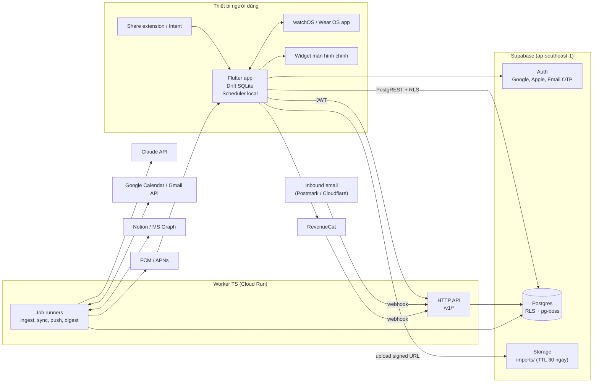
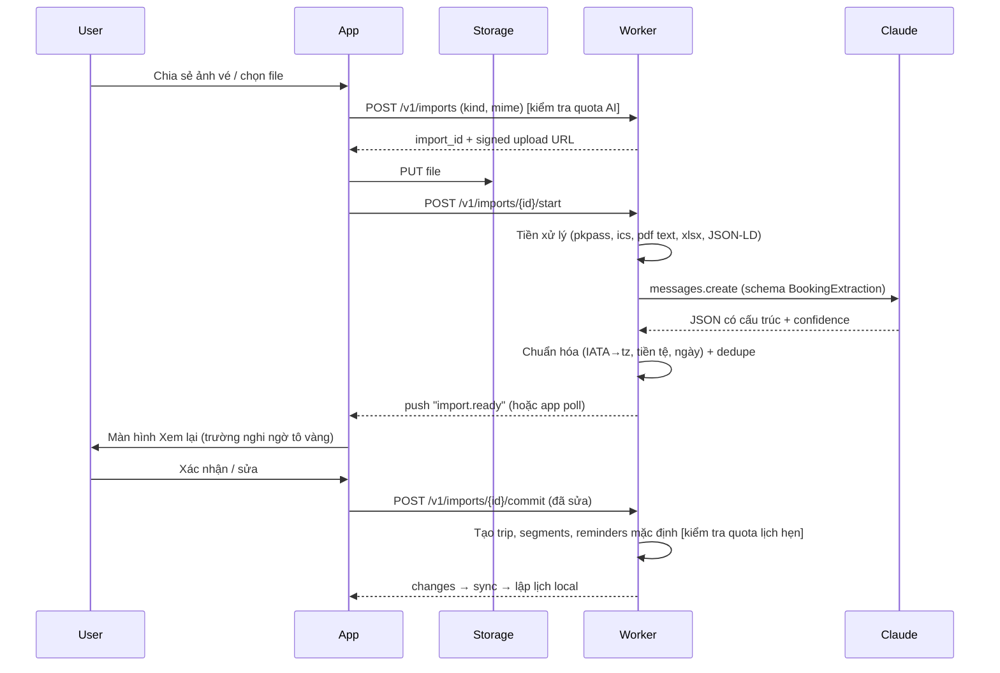

# Kiến trúc hệ thống

> TL;DR: App Flutter offline-first (SQLite) tự lập lịch thông báo local. Supabase giữ dữ liệu, auth, file.
> Worker TypeScript lo AI ingestion, email inbound, đồng bộ Google, push, webhook thanh toán.
> Quyết định và lý do: `decisions.md`. Schema: `data-model.md`. API: `api-spec.md`.

## 1. Sơ đồ thành phần

## 2. Thành phần và trách nhiệm

| Thành phần | Trách nhiệm | Không làm |
|---|---|---|
| Flutter app | UI, DB local, lập lịch thông báo, STT on-device, parse nhanh câu tiếng Việt, outbox sync | Gọi Claude trực tiếp, quyết định entitlement cuối cùng |
| Watch app | Hiển thị việc hôm nay/chuyến đi sắp tới, Done/Snooze, complication/tile, đọc chính tả để thêm nhanh | Lưu trữ lâu dài, sync trực tiếp với server (Phase 2 chỉ qua điện thoại) |
| Supabase Postgres | Nguồn sự thật đồng bộ, RLS theo `user_id`, trigger đếm quota, hàng đợi pg-boss | Logic AI |
| Supabase Storage | File import tạm thời (ảnh, pdf, xlsx, md). Tự xóa sau 30 ngày (Free 7 ngày) | Lưu vĩnh viễn tài liệu gốc (trừ khi user bật "Giữ bản gốc" ở gói trả phí) |
| Worker API | Endpoint cần quyền cao: tạo job import, xác nhận import, entitlement, webhook | CRUD thông thường (đi PostgREST) |
| Worker jobs | `ingest.*`, `email.inbound`, `gcal.sync`, `gmail.scan`, `push.fanout`, `digest.daily`, `cleanup.*` | |

## 3. Luồng chính

### 3.1 Tạo nhắc nhở nhanh (offline được)
1. Người dùng gõ/nói: "Mai 8h sáng nhắc uống thuốc, lặp mỗi ngày".
2. `QuickParser` (Dart, on-device) tách: tiêu đề, thời điểm, lặp, mức ưu tiên. Độ tin cậy >= 0,8 thì điền form ngay.
   Thấp hơn và đang online thì gửi `/v1/parse/text` (LLM) để hỏi lại.
3. Kiểm tra quota local (entitlement cache). Vượt thì hiện paywall theo ngữ cảnh.
4. Ghi Drift, thêm vào `outbox`, gọi `ReminderScheduler.reschedule(window)`.
5. Có mạng: outbox đẩy lên server; server xác thực quota; trả `version`.

### 3.2 Import booking từ ảnh/pdf/xlsx/email

Chi tiết pipeline: `ai-ingestion.md`.

### 3.3 Thông báo kêu và hành động
Thông báo local có action: **Xong**, **Hoãn 10 phút**, **Hoãn 1 giờ**, **Mở**. Action xử lý ngay trong background
(Android `BroadcastReceiver`, iOS `UNNotificationAction` + background handler), ghi DB local và outbox.
Đồng hồ nhận cùng thông báo (mirror) kèm action. Chi tiết: `reminder-engine.md`.

## 4. Đồng bộ (Sync)
- Mỗi bảng đồng bộ có: `id uuid` (client sinh, UUIDv7), `user_id`, `updated_at`, `version bigint` (server gán từ sequence),
  `deleted_at` (tombstone), `device_id` sửa cuối.
- **Push:** client gửi batch mutation từ `outbox` → RPC `sync_push(mutations jsonb)`; server áp dụng trong transaction,
  kiểm tra quota, trả `version` mới hoặc lỗi từng item (`quota_exceeded`, `conflict`).
- **Pull:** `sync_pull(since_version)` trả mọi hàng có `version > since` (phân trang 500).
  Kích hoạt: mở app, kéo để refresh, silent push `sync.tickle`, background fetch (iOS BGAppRefresh, Android WorkManager 15').
- **Xung đột:** Last-Writer-Wins theo trường (field-level) dựa trên `updated_at` client + `device_id`, riêng `notes`
  (văn bản dài) giữ cả 2 phiên bản và đánh dấu `conflict` cho người dùng chọn.
- Realtime (Supabase Realtime) chỉ bật khi app đang mở để giảm pin.

## 5. Yêu cầu phi chức năng
| Thuộc tính | Mục tiêu |
|---|---|
| Độ chính xác giờ kêu | 99,5% thông báo kêu trong ±60 giây (đo bằng telemetry `fired_at - due_at`) |
| Khởi động lạnh | < 1,5 s trên máy tầm trung (Android 2022) |
| Import AI | p50 < 8 s, p95 < 20 s từ lúc upload xong tới khi có màn Xem lại |
| Độ chính xác trích xuất | >= 95% trường bắt buộc đúng trên eval set booking (giờ, ngày, mã đặt chỗ, địa điểm) |
| Khả dụng API | 99,9%/tháng; app vẫn dùng được 100% chức năng cơ bản khi server chết |
| Bảo mật | RLS mọi bảng; mã hóa at-rest (Supabase mặc định); TLS 1.2+; xóa tài khoản trong 30 ngày |
| Quan sát | Sentry (app + worker), OpenTelemetry cho worker, PostHog cho product analytics (tự host hoặc EU) |

## 6. Môi trường
`local` (supabase CLI + worker dev) → `staging` (project Supabase riêng, TestFlight/Internal testing) → `prod`.
Secrets qua Secret Manager của Cloud Run và Supabase Vault; app chỉ có `SUPABASE_URL`, `anon key`, `RC public key`.

## 7. Rủi ro kỹ thuật chính
| Rủi ro | Giảm thiểu |
|---|---|
| OEM Android (Xiaomi, Oppo, Vivo, Samsung) kill app, thông báo trễ | `setAlarmClock` cho nhắc quan trọng, hướng dẫn tắt tối ưu pin theo hãng, telemetry trễ |
| iOS giới hạn 64 thông báo chờ | Rolling window + BGAppRefresh + silent push nạp lại (`reminder-engine.md`) |
| AI đọc sai giờ bay → lỡ chuyến | Bắt buộc màn Xem lại, đối chiếu IATA tz, cảnh báo khi giờ đến < giờ đi mà không qua đêm |
| Chi phí AI vượt doanh thu | Quota AI theo gói, tiền xử lý deterministic trước, cache theo hash file, đo cost/import |
| Duyệt OAuth Google chậm | Bắt đầu nộp verification sớm (Phase 1), dùng email forward trong lúc chờ |
