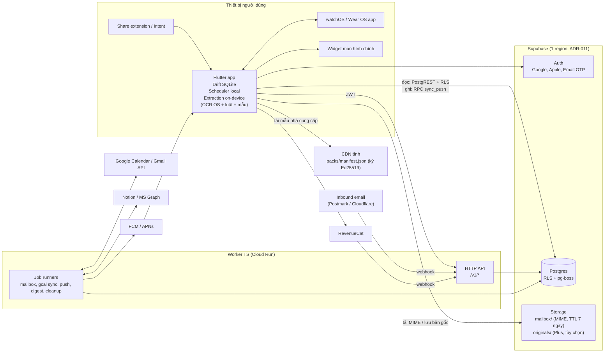
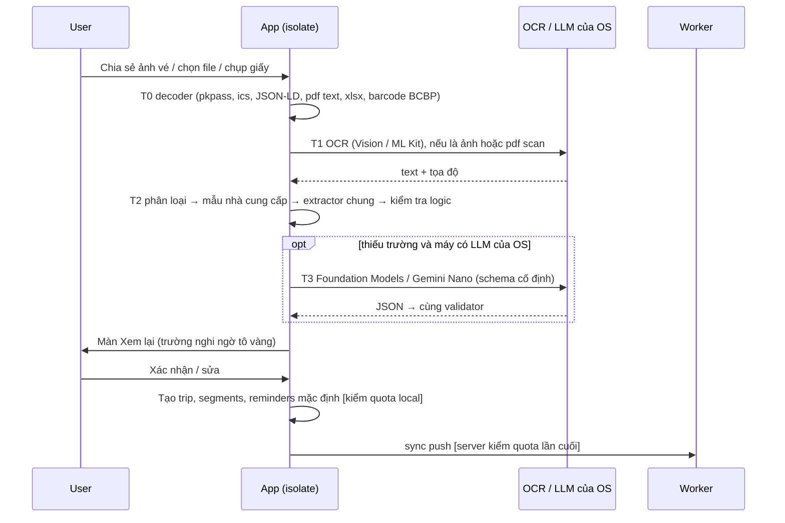

# Kiến trúc hệ thống

> TL;DR: App Flutter offline-first (SQLite) tự lập lịch thông báo local và **tự đọc ảnh/file trên máy** (không gọi AI API trả phí).
> Supabase giữ dữ liệu và auth. Worker TypeScript lo sync có quota, hộp thư email, đồng bộ Google, push, webhook thanh toán.
> Pipeline đọc file: `on-device-extraction.md`.
> Quyết định và lý do: `decisions.md`. Schema: `data-model.md`. API: `api-spec.md`.

## 1. Sơ đồ thành phần

## 2. Thành phần và trách nhiệm

| Thành phần | Trách nhiệm | Không làm |
|---|---|---|
| Flutter app | UI, DB local, lập lịch thông báo, STT của OS, parse câu tiếng Việt, **toàn bộ trích xuất ảnh/pdf/xlsx/md/email**, outbox sync | Gọi AI API trả phí, quyết định entitlement cuối cùng |
| Watch app | Hiển thị việc hôm nay/chuyến đi sắp tới, Done/Snooze, complication/tile, đọc chính tả để thêm nhanh | Lưu trữ lâu dài, sync trực tiếp với server (Phase 2 chỉ qua điện thoại) |
| Supabase Postgres | Nguồn sự thật đồng bộ, RLS theo `user_id`, trigger đếm quota, hàng đợi pg-boss | Logic AI |
| Supabase Storage | MIME email chờ máy tải về (TTL 7 ngày); bản gốc tài liệu nếu người dùng Plus bật "Giữ bản gốc" | Nhận file để phân tích (máy tự phân tích) |
| Worker API | Endpoint cần quyền cao: sync có quota, entitlement, hộp thư, OAuth, webhook | CRUD thông thường (đi PostgREST), đọc nội dung tài liệu |
| Worker jobs | `mailbox.store`, `gcal.sync`, `push.fanout`, `digest.daily`, `cleanup.*` | Gọi LLM |

## 3. Luồng chính

### 3.1 Tạo nhắc nhở nhanh (offline được)
1. Người dùng gõ/nói theo ngôn ngữ của mình: "Mai 8h sáng nhắc uống thuốc, lặp mỗi ngày" / "Take pills every day at 8am".
2. NLU luật (Dart, gói ngữ pháp theo ngôn ngữ, `voice-and-text-input.md`) tách tiêu đề, thời điểm, lặp, ưu tiên thành chip.
   Phần không chắc để trống hoặc hiện lựa chọn; không gọi server.
3. Kiểm tra quota local (entitlement cache). Vượt thì hiện paywall theo ngữ cảnh.
4. Ghi Drift, thêm vào `outbox`, gọi `ReminderScheduler.reschedule(window)`.
5. Có mạng: outbox gửi RPC `sync_push`; server kiểm quota và merge; trả `version`.

### 3.2 Import booking từ ảnh/pdf/xlsx/email (hoàn toàn trên máy)

Email chuyển tiếp: server chỉ lưu MIME rồi push `inbox.new`, máy tải về và chạy đúng pipeline trên.
Chi tiết: `on-device-extraction.md`.

### 3.3 Thông báo kêu và hành động
Thông báo local có action: **Xong**, **Hoãn 10 phút**, **Hoãn 1 giờ**, **Mở**. Action xử lý ngay trong background
(Android `BroadcastReceiver`, iOS `UNNotificationAction` + background handler), ghi DB local và outbox.
Đồng hồ nhận cùng thông báo (mirror) kèm action. Chi tiết: `reminder-engine.md`.

## 4. Đồng bộ (Sync)
- Cột đồng bộ chuẩn `SYNC_COLS` (`data-model.md` §3); `id` do client sinh (UUIDv7). Đường ghi duy nhất là RPC `sync_push` (ADR-012), spec ở `api-spec.md` §1.
- **Push:** batch mutation từ `outbox` → `sync_push`; áp dụng trong transaction, kiểm quota, trả `version` hoặc lỗi từng item (`quota_exceeded`, `conflict`).
- **Pull:** `sync_pull(since)` phân trang 500. Kích hoạt: mở app, kéo để refresh, silent push `sync.tickle`, background fetch (iOS BGAppRefresh, Android WorkManager 15').
- **Xung đột:** Last-Writer-Wins **theo trường** bằng Hybrid Logical Clock lưu trong `field_clock`. Riêng `notes` (văn bản dài): nếu cả 2 phía sửa
  từ cùng một bản gốc thì giữ cả 2 và hiện màn "Chọn bản ghi chú" (`uiux/ux-flows-and-screens.md` §3.6).
- **Tài khoản ẩn danh → tài khoản thật:** nếu tài khoản đích chưa có dữ liệu thì chuyển nguyên; nếu đã có thì gộp (union), dedupe theo `source_ref`
  và `(title, starts_at)`, quota tính sau khi gộp (phần vượt thành `archived_reason='quota'`), hiện tóm tắt cho người dùng.
- **Giới hạn thiết bị** (ADR-013: Free 1; Plus 1 điện thoại + 1 tablet + 1 máy tính): sau đăng nhập gọi `profile_init` → `session_claim`; phiên cũ bị kết thúc, mọi đọc/ghi của nó trả `session_revoked`.
- Realtime (Supabase Realtime) chỉ bật khi app đang mở để giảm pin.
- Nhiều thiết bị cùng kêu nhắc: `reminder-engine.md` §8.

## 5. Yêu cầu phi chức năng
| Thuộc tính | Mục tiêu |
|---|---|
| Độ chính xác giờ kêu | 99,5% thông báo kêu trong ±60 giây (`late_ms`, `docs/product/analytics-events.md`) |
| Khởi động lạnh | < 1,5 s trên máy tầm trung (Android 2022) |
| Trích xuất (trên máy) | Tốc độ và độ chính xác: `on-device-extraction.md` §11-12 |
| Hiểu ngôn ngữ (NLU, giọng nói) | Ngưỡng theo cấp locale: `voice-and-text-input.md` §7 |
| Chi phí theo lượt import | 0 (không gọi API trả phí) |
| Khả dụng API | 99,9%/tháng; app vẫn dùng được 100% chức năng cơ bản khi server chết |
| Bảo mật | `security-privacy.md` (RLS, mã hóa at-rest, TLS 1.2+, xóa tài khoản ≤ 30 ngày) |
| Quan sát | Sentry (app + worker), OpenTelemetry cho worker, PostHog EU (consent theo `analytics-events.md`) |
| Bản địa hóa | Mọi locale đã phát hành qua cổng `i18n-l10n.md` §9 |

## 6. Môi trường
`local` (supabase CLI + worker dev) → `staging` (project Supabase riêng, TestFlight/Internal testing) → `prod`.
Secrets qua Secret Manager của Cloud Run và Supabase Vault; app chỉ có `SUPABASE_URL`, `anon key`, `RC public key`.

## 7. Rủi ro kỹ thuật chính
| Rủi ro | Giảm thiểu |
|---|---|
| OEM Android kill app, thông báo trễ | `reminder-engine.md` §2 |
| iOS giới hạn 64 thông báo chờ | Rolling window (`reminder-engine.md` §1) |
| Đọc sai giờ bay → lỡ chuyến | Bắt buộc màn Xem lại, đối chiếu IATA tz, cảnh báo khi giờ đến < giờ đi mà không qua đêm |
| Bố cục tài liệu lạ đọc kém (không có LLM đám mây) | Mẫu cho top nhà cung cấp cập nhật qua CDN, LLM của OS khi có, vòng "Gửi mẫu để cải thiện" |
| Spam qua email forward làm đầy storage | Giới hạn ở `on-device-extraction.md` §8 |
| Sai giờ do DST/múi giờ ở thị trường global | Quy tắc + bộ test ở `reminder-engine.md` §5 |
| Duyệt OAuth Google chậm | Bắt đầu nộp verification sớm (Phase 1), dùng email forward trong lúc chờ |
