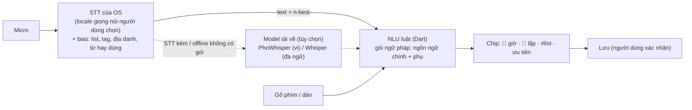

# Nhập bằng giọng nói và câu tự nhiên (đa ngôn ngữ, đa vùng miền)

> TL;DR: Giọng nói → STT của hệ điều hành (miễn phí, chọn đúng biến thể vùng như en-GB, es-MX, pt-BR) có bias từ vựng của người dùng.
> Nếu STT của OS kém với giọng vùng miền (ví dụ tiếng Việt miền Trung) thì có thể tải model mở chạy trên máy (PhoWhisper, Whisper).
> Câu chữ → bộ phân tích luật dùng "gói ngữ pháp" theo ngôn ngữ (dữ liệu, không phải code). Nó hiểu từ địa phương và câu pha
> 2 ngôn ngữ. Không gọi AI API trả phí (ADR-010). Ngôn ngữ nào được hỗ trợ tới mức nào: `i18n-l10n.md` mục 2.

## 1. Luồng

## 2. Chọn ngôn ngữ và giọng vùng
- **Ba thiết lập tách biệt** (Cài đặt → Ngôn ngữ): ngôn ngữ giao diện · định dạng vùng (ngày, giờ, số, đầu tuần) · **ngôn ngữ giọng nói** (1 chính + tối đa 2 phụ).
  Mặc định suy từ máy, ví dụ máy `en_GB` thì giọng nói là `en-GB`.
- Danh sách biến thể lấy **lúc chạy** từ OS, không hard-code: Android `SpeechRecognizer.checkRecognitionSupport` / `getSupportedLanguages`;
  iOS `SFSpeechRecognizer.supportedLocales()` và `SpeechTranscriber.supportedLocales` (iOS 26+).
- Các biến thể cần có sẵn trong UI khi OS hỗ trợ: `en-US/GB/AU/IN/CA`, `es-ES/MX/US/419`, `pt-BR/PT`, `fr-FR/CA`, `zh-CN/TW`, `yue-HK`, `ar-SA/EG/AE`,
  `de-DE/AT/CH`, `vi-VN`, `ja-JP`, `ko-KR`, `id-ID`, `th-TH`, `hi-IN`.
- Tiếng Việt: các engine thường chỉ có `vi-VN`, không tách Bắc/Trung/Nam. Giọng vùng được xử lý bằng 3 cách: bias từ vựng (mục 3),
  từ địa phương trong gói ngữ pháp (mục 5) và model PhoWhisper tùy chọn (mục 4). Người dùng chọn "Giọng: Bắc / Trung / Nam / Không rõ"
  để app bật từ điển vùng phù hợp và đo chất lượng theo vùng. Câu hỏi này không bắt buộc và không dùng cho mục đích khác.

## 3. Engine STT theo nền tảng
| Nền tảng | Engine | Tính năng dùng |
|---|---|---|
| iOS 26+ | `SpeechAnalyzer` + `SpeechTranscriber`/`DictationTranscriber` (on-device, model tải theo locale) | `AnalysisContext.contextualStrings` để bias; custom vocabulary qua `SFSpeechLanguageModel` |
| iOS 17+ (fallback) | `SFSpeechRecognizer(locale:)`, `requiresOnDeviceRecognition` khi locale hỗ trợ; nếu không thì dùng dịch vụ của Apple (miễn phí, giới hạn tần suất) | `contextualStrings` (khoảng ≤ 100 cụm); `SFCustomLanguageModelData` (iOS 17) cho từ vựng lớn |
| Android 13+ | `SpeechRecognizer`, ưu tiên `createOnDeviceSpeechRecognizer` khi gói ngôn ngữ đã cài | `EXTRA_BIASING_STRINGS` (API 33) |
| Android 14+ | như trên | `EXTRA_ENABLE_LANGUAGE_SWITCH` + danh sách ngôn ngữ cho phép (câu pha 2 ngôn ngữ), `EXTRA_ENABLE_LANGUAGE_DETECTION` |
| Android (tùy chọn) | ML Kit GenAI Speech Recognition (một số locale đang beta, ví dụ vi-VN) | Đánh giá ở spike V0 |

**Danh sách bias** (tạo trên máy, không gửi đi): tên list, tag, 200 tiêu đề hay dùng, tên địa điểm/khách sạn trong chuyến đi sắp tới,
từ khóa miền (vi: "tái khám", "rằm", "mùng", "giỗ", "check-in"; en: "check-in", "boarding", "refill"...). Cập nhật khi dữ liệu đổi.

## 4. Model mở chạy trên máy (tùy chọn, Phase 2)
| Model | Dùng khi | Kích thước (ước lượng, bản lượng tử hóa) | Giấy phép |
|---|---|---|---|
| **PhoWhisper** base/small (VinAI, fine-tune Whisper trên 844 giờ tiếng Việt nhiều vùng miền) | Người dùng tiếng Việt thấy STT của OS hay sai giọng địa phương, hoặc cần offline hoàn toàn | base ~60-80 MB, small ~200-250 MB | Repo GitHub: Apache-2.0; model card các bản ghi khác nhau (Apache-2.0 / BSD-3): **kiểm tra từng checkpoint** |
| **Whisper** base/small đa ngữ (OpenAI) | Ngôn ngữ OS không có STT offline | tương tự | MIT |
- Chạy bằng whisper.cpp qua package Flutter (ví dụ `whisper_cpp_flutter_plus`, `whisper_ggml`: kiểm tra bảo trì trước khi chọn), có VAD.
- Tải qua Wi-Fi khi người dùng bật "Nhận dạng nâng cao", lưu trong thư mục app, xóa được. Không tốn chi phí server ngoài CDN.
- Chỉ bật mặc định cho locale nào eval cho thấy tốt hơn OS rõ rệt (mục 7).

## 5. NLU luật: gói ngữ pháp theo ngôn ngữ
Engine Dart duy nhất (`packages/parsers/nlu/`). Mỗi ngôn ngữ là một **gói dữ liệu** `nlu/packs/<lang>.yaml`:
| Phần của gói | Ví dụ (vi) | Ví dụ (en) |
|---|---|---|
| Từ đệm cần bỏ | "nhắc tôi", "nhớ", "đặt lịch" | "remind me to", "don't forget" |
| Số bằng chữ | một, hai, mười lăm, rưỡi | one, fifteen, half, quarter |
| Ngày tương đối | hôm nay, mai, ngày kia, **mốt**, **bữa nay**, **bữa sau**, tuần sau, **tuần tới** | today, tomorrow, the day after tomorrow, next week, **fortnight** (en-GB) |
| Buổi → khung giờ | sáng 5-11, trưa 11-13, chiều 13-18, tối 18-22, đêm/khuya 22-4 | morning, noon, afternoon, evening, tonight |
| Cách nói giờ | "3 giờ rưỡi", "**3 giờ kém 15**" (Bắc) = 2:45, "10h30", "10g30" | "half past 3", "quarter to 4", "**half seven**" (en-GB) = 7:30, "7pm" |
| Thứ/tháng | thứ hai… chủ nhật, CN, T2; tháng giêng, tháng chạp | Mon…Sun, Jan… |
| Lặp | "hằng ngày", "mỗi sáng", "thứ 2,4,6", "ngày 5 hàng tháng", "**rằm**", "**mùng 1**" | "every weekday", "every other Tuesday", "on the 5th of every month" |
| Thứ tự ngày số | `dd/mm` | theo vùng: en-US `mm/dd`, en-GB `dd/mm` |
| Từ địa phương | Trung: "ni" (này), "chừ" (bây giờ), "tối ni", "mai ni"; Nam: "hồi sáng" (đã qua), "lát nữa", "chút xíu nữa" | en-AU "arvo" (chiều) |
- Gói cho ngôn ngữ không có dấu cách (ja, zh, th) cần tokenizer riêng: ja/zh tách theo từ điển ngày giờ ("明日の午後3時", "下周五", "后天"); th theo từ điển.
- Bẫy theo ngôn ngữ: de "halb acht" = 7:30 (không phải 8:30); es "mañana" vừa là "ngày mai" vừa là "buổi sáng"; pt-PT/pt-BR khác từ;
  zh "下周" ở các vùng hiểu khác nhau. Mỗi bẫy phải có test.
- **Câu pha 2 ngôn ngữ**: engine chạy gói chính rồi gói phụ trên phần chưa hiểu ("họp **meeting** với client **3pm** thứ 6").
- **Mơ hồ thì hỏi, không đoán**: `03/04` khi định dạng vùng không rõ, "thứ 6" khi hôm nay là thứ 6 (hôm nay hay tuần sau?). Trường hợp này hiện chip
  có 2 lựa chọn. Quy tắc mặc định của từng gói được ghi trong file gói.
- Nguồn tham khảo luật: thư viện `chrono` (JS, MIT) có parser nhiều ngôn ngữ. Có thể port quy tắc sang gói dữ liệu.
  Phương án dự phòng: chạy chrono trong QuickJS trên máy (spike V0 so sánh).
- Fixtures: `packages/parsers/fixtures/nlu/<lang>.json`, mỗi gói ≥ 300 câu (gói vi có câu của cả 3 vùng). Gói chỉ được bật ở cấp hỗ trợ A/B khi đạt ngưỡng mục 7.

## 6. Hậu xử lý văn bản STT
- Chuẩn hóa số: STT có thể trả "ba giờ chiều" hoặc "3 giờ chiều"; gói ngữ pháp hiểu cả hai.
- Dùng **n-best** (Android `RESULTS_RECOGNITION` nhiều kết quả; iOS `transcriptions`): chọn bản cho kết quả NLU đầy đủ nhất.
- Viết hoa đầu câu, bỏ từ đệm, giữ nguyên tên riêng trong danh sách bias.
- Tách nhiều việc theo liên từ của gói ("và", "rồi", "sau đó"; "and", "then"; "y", "luego"...).

## 7. Đánh giá theo ngôn ngữ và vùng
| Chỉ số | Định nghĩa | Ngưỡng cấp A | Ngưỡng cấp B |
|---|---|---|---|
| Intent accuracy | % câu ra đúng **tiêu đề + thời điểm + lặp** | ≥ 92% | ≥ 85% |
| Sai nguy hiểm | % câu ra giờ sai mà không hiện chip mơ hồ | ≤ 1% | ≤ 2% |
| WER STT | Chỉ để chọn engine, không làm ngưỡng phát hành | | |
- Bộ câu nói: mỗi locale cấp A ≥ 300 câu, ≥ 20 người nói. **Tiếng Việt: chia đều Bắc/Trung/Nam**; tiếng Anh: US/UK/AU/IN; tiếng Tây Ban Nha: ES/MX.
  Thu từ beta tester có đồng ý ghi âm (xóa audio sau khi chấm, chỉ giữ transcript đã ẩn danh).
  Bộ dữ liệu công khai (Common Voice và tương tự, kiểm tra giấy phép từng bộ) chỉ dùng để so engine.
- Báo cáo theo vùng: nếu một vùng thấp hơn ngưỡng thì bật gợi ý "Nhận dạng nâng cao" (mục 4) cho người dùng chọn vùng đó.
- Telemetry ẩn danh (opt-in): `{voice_locale, region_hint, engine, chips_edited[]}`, không có audio hay văn bản.

## 8. Quyền riêng tư
- Audio không lưu, không gửi lên server RemindMe. Nếu OS dùng dịch vụ nhận dạng online (Apple/Google), ghi rõ trong Privacy Policy
  và cho phép bật "Chỉ nhận dạng trên máy" (khi đó locale nào không có gói offline sẽ bị ẩn nút mic hoặc gợi ý tải model mục 4).
- iOS cần quyền Microphone + Speech Recognition, có chuỗi giải thích đã dịch cho từng ngôn ngữ.
