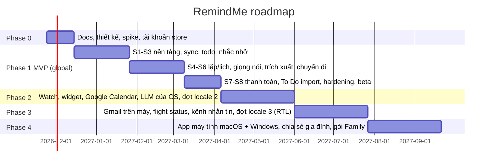

# Kế hoạch triển khai

> TL;DR: 5 phase trong ~10 tháng (43 tuần). **Global ngay từ Phase 1**: launch đồng thời đợt locale 1 (`i18n-l10n.md` §2).
> Phase 1 (MVP) = 8 sprint x 2 tuần, beta công khai đa quốc gia khoảng tháng 4/2027, trước khi Microsoft To Do ngừng app (30/06/2027).
> Đội tối thiểu: 2 Flutter (1 người kiêm native iOS/Android), 1 backend + parser/mẫu, 1 designer bán thời gian, 1 PM/QA,
> dịch giả bản ngữ thuê theo locale. Không dùng AI API trả phí theo đầu người dùng (ADR-010).
> Ba nhánh việc có kế hoạch chi tiết bên dưới: **E** (trích xuất tài liệu), **V** (giọng nói + NLU), **L** (bản địa hóa).
> Kiểm thử và phát hành: `docs/engineering/testing-and-release.md`. Khung quy trình: NEXUS-Sprint (`docs/guides/ai-dev-workflow.md`).

## Tổng quan

Quy ước ưu tiên trong PRD: **P0** = Phase 1, **P1** = Phase 2, **P2** = Phase 3, **P3** = Phase 4 trở đi.

## Phase 0: Khám phá & nền móng (3 tuần, đang làm)
- [x] Tài liệu hệ thống, UI/UX, nghiên cứu đối thủ, kế hoạch
- [x] Nghiên cứu thị trường global (`research/global-market.md`); **chờ chủ dự án chốt** đợt locale 1, region, nhóm giá theo đề xuất §9
- [ ] Phỏng vấn 15-20 người dùng (VN + ≥ 2 thị trường đợt 1), xác nhận giả thuyết PRD §6
- [ ] Prototype 6 luồng P0 (`uiux/ux-flows-and-screens.md` mục đầu), test với 5 người, có bản tiếng Anh
- [ ] Đăng ký Apple Developer (tổ chức, D-U-N-S), Google Play Console, domain, email, Firebase, Supabase (staging/prod); chuẩn bị hồ sơ OAuth Google (nộp ở Phase 1)
- [ ] Thu ≥ 300 mẫu tài liệu ẩn danh, ≥ 20 nhà cung cấp, **≥ 3 thị trường** (E0.4). Đã có cấu trúc, schema, quy trình ẩn danh: `packages/parsers/fixtures/README.md`
- [ ] Spike E0 (OCR), V0 (giọng nói/NLU) cần máy thật; L0 phần tài liệu xong (`docs/l10n/`), còn chọn TMS sau trial + thuê dịch giả
- [x] Khung repo: CI (`.github/workflows/ci.yml`), lint chuỗi hard-code, kiểm tham chiếu docs, hook commit-msg. Workspace Flutter/Dart làm ở S1
- [x] (Kéo sớm từ S1-S2) Supabase migrations + RLS + RPC sync/quota/phiên + pgTAP (`supabase/`)
- [x] (Kéo sớm S1) Workspace Dart/Flutter 3.50.1: `packages/core` (HLC, UUIDv7, entitlement, giao thức sync), `packages/platform`, `packages/data`
  (Drift + outbox + SyncEngine, contract test với Postgres), `apps/client` khung (theme token, go_router + shell thích ứng, ARB en/vi + pseudo-locale, 14 test widget). Còn của S1: flavors, auth, font
- [x] (Kéo sớm S2) Nối Drift vào app: `ItemsRepository`, Hôm nay (Quá hạn/Hôm nay/Chưa đặt giờ/Đã xong), chi tiết item (tên, ghi chú, ưu tiên, xóa), Quick Add lưu việc; offline, outbox chờ `SupabaseSyncApi`
- [x] (Kéo sớm S2/S3) V1 engine NLU + gói `en`, `vi` (bộ câu tổng hợp, chờ bộ thật ≥ 300), recurrence engine + âm lịch VN/TQ/HQ (`packages/core`)
- [x] (Kéo sớm S3) Reminder engine offline: rolling window, DST/tz, adapter thông báo + nút Xong/Hoãn, Hôm nay trải lần lặp. Còn: thử máy thật, `setAlarmClock` native, BGAppRefresh, onboarding OEM, telemetry
- [x] (Kéo sớm S2/S4) List + tìm kiếm không dấu; sửa ngày/giờ và chọn lặp (RRULE + âm lịch) ở chi tiết item
- [x] (Kéo sớm S5) E1.1 `.ics`/`.pkpass`, E1.4 BCBP, phần JSON-LD của E1.2; khung harness E3.5 trên fixtures
- **Gate:** PRD chốt sau phỏng vấn; prototype pass (≥ 4/5 người hoàn thành tác vụ chính); spike có kết luận engine OCR/STT cho từng nền tảng.

## Phase 1: MVP (16 tuần = 8 sprint)
| Sprint | Mục tiêu | Deliverable chính |
|---|---|---|
| S1 | Bootstrap | Flutter `apps/client` (flavors; Android, iOS, iPadOS) + package `core`/`data`/`platform`, `PlatformCapabilities`, layout thích ứng 3 kích thước (`multi-platform.md` §2), theme từ token, go_router, Drift schema, Supabase migrations + RLS + pgTAP, **auth (anonymous + Google + Apple + email OTP)**, khung i18n (L1), CI build/test |
| S2 | Todo core + sync | Lists, items, Hôm nay, chi tiết item, **RPC `sync_push`/`sync_pull` + entitlement cơ bản (`plan_entitlements`, cache client)**, Quick Add gõ (V1 gói `en`, `vi`), tìm kiếm |
| S3 | Reminder engine | Rolling window, Android exact alarm + receivers, iOS categories/actions, snooze, DST/tz (`reminder-engine.md` §5), nhiều thiết bị, telemetry, onboarding OEM |
| S4 | Lặp, hệ lịch, giọng nói | RRULE UI + engine, âm lịch VN/TQ/HQ, ngày lễ/cuối tuần theo quốc gia (L3), STT của OS + bias (V2), đa việc trong 1 câu; E3.2/E4.3 bắt đầu song song |
| S5 | Trích xuất nền tảng | E1 decoder, E2 OCR plugin, E3 bộ máy luật + eval CI |
| S6 | Mẫu, chuyến đi, email | E4 mẫu đợt 1 + CDN, E5 màn Xem lại, trips + timeline, nhắc mặc định booking, E6 hộp thư, share extension, Hộp đề xuất, "Thêm vào lịch máy" (EventKit/CalendarContract) |
| S7 | Thanh toán & To Do | RevenueCat, paywall theo ngữ cảnh, giá theo storefront, Microsoft To Do importer, Lịch tháng/tuần, gói NLU cấp B (V1) |
| S8 | Hardening & beta | Xóa/xuất dữ liệu, LQA mọi locale đợt 1 (L4), accessibility test plan, hiệu năng, Sentry/PostHog + consent, store listing đa ngôn ngữ, TestFlight + Play closed test |
- **Gate (Reality Checker mặc định "NEEDS WORK" tới khi có bằng chứng):** NFR `system-architecture.md` §5 đạt trên ≥ 6 máy thật
  (Xiaomi, OPPO, vivo, Samsung, Pixel, iPhone cũ/mới); eval trích xuất đạt `on-device-extraction.md` §11; mọi locale đợt 1 qua cổng `i18n-l10n.md` §9;
  crash-free ≥ 99,5%; 0 lỗi P0 mở.
- Launch: beta công khai (Play open testing + TestFlight public link) ở các storefront của đợt locale 1, rồi production.

## Phase 2: Hệ sinh thái (8 tuần)
Apple Watch app + complication, Wear OS app + Tile, widget iOS/Android, Google Calendar 2 chiều (sau OAuth verification), Google Tasks, Notion,
feed ICS, import Todoist/TickTick, (tùy chọn) app iPad chạy trên Mac Apple Silicon, nhắc kiểu báo thức, nhắc vị trí, Siri/App Intents, E7 (LLM của OS), V3 (model giọng nói tải về),
mẫu cho thị trường đợt 2, **đợt locale 2** (`i18n-l10n.md` §2), Hijri.

## Phase 3: Thông minh hơn (8 tuần)
Gmail chạy trên máy, trạng thái chuyến bay + Live Activities, kênh nhắn tin (Zalo/LINE/Kakao/WhatsApp), digest email, gợi ý ("3 việc trùng giờ"),
thống kê thói quen, E8 nếu cần, **đợt locale 3 (gồm RTL `ar`, `he`)**, Hebrew/Persian/lịch Ấn Độ.

## Phase 4: Mở rộng
**App máy tính macOS + Windows** (kế hoạch D bên dưới, ADR-014), chia sẻ chuyến đi/list cho gia đình, gói Family, data residency EU nếu cần (ADR-011).
Sau đó: web app (Flutter web) đọc/sửa. Tới khi có app máy tính, paywall Plus ghi "máy tính: sắp có" (`desktop_client_available = false`).

## E. Trích xuất tài liệu trên máy (chi tiết)
Ước lượng theo ngày công (d) của 1 dev, chưa gồm review/QA. Thiết kế: `architecture/on-device-extraction.md`.

### E0. Spike & dữ liệu (Phase 0, ~8d)
| # | Việc | d | AC |
|---|---|---|---|
| E0.1 | App thử chụp/chọn ảnh → OCR ML Kit (Android, iOS) + Vision (iOS), xuất `ocr.json` | 3 | Chạy trên ≥ 4 máy thật (Xiaomi, Samsung, iPhone 12, iPhone 15 Pro) |
| E0.2 | Đo chất lượng OCR theo hệ chữ của đợt 1 (Latin gồm tiếng Việt, CJK): `supportedRecognitionLanguages` của Vision, CER trên 50 ảnh/hệ chữ | 2 | Bảng CER ML Kit vs Vision; chọn engine mặc định cho iOS |
| E0.3 | Thử Foundation Models (iOS 26.1+) và Gemini Nano Prompt API | 2 | Có/không, độ trễ, chất lượng trên 20 mẫu |
| E0.4 | Quy trình thu & ẩn danh mẫu, cấu trúc `fixtures/docs/<id>/{input, ocr.android.json, ocr.ios.json, expected.json}` | 1 | ≥ 300 mẫu, ≥ 20 nhà cung cấp, ≥ 3 thị trường, đủ 6 loại tài liệu |

### E1. Decoder T0 (S5, ~7d), `packages/parsers/decoders/`
| # | Việc | d | AC |
|---|---|---|---|
| E1.1 | `.pkpass`, `.ics` (VEVENT/VTODO/RRULE/VALARM) | 1,5 | 20 file mẫu pass |
| E1.2 | MIME + HTML → text sạch + JSON-LD/Microdata schema.org Reservation | 2 | 30 email mẫu (OTA global + hãng VN) |
| E1.3 | PDF text layer có tọa độ (`pdfrx`) → `OcrDocument`; phát hiện PDF scan → render ảnh | 1,5 | PDF 20 trang < 3 s |
| E1.4 | Parser IATA BCBP từ barcode | 1 | 100% đúng trên 20 boarding pass + test vector chuẩn |
| E1.5 | xlsx/csv: header detection, từ điển cột đa ngôn ngữ, suy kiểu, serial date | 1 | 15 file mẫu (≥ 3 ngôn ngữ); 5.000 dòng < 3 s |

### E2. Plugin OCR native (S5, ~7d)
| # | Việc | d | AC |
|---|---|---|---|
| E2.1 | Interface `OcrEngine` + `OcrDocument`, chạy nền | 1 | Unit test |
| E2.2 | Android: ML Kit Text v2 (Latin + CJK, unbundled + fallback), Barcode, Document Scanner | 2 | 1 ảnh < 1,5 s; máy không GMS vẫn chạy |
| E2.3 | iOS: Vision / VisionKit, hoặc ML Kit nếu E0.2 chọn | 2 | Như trên |
| E2.4 | Tiền xử lý ảnh; hậu xử lý NFC + chuẩn hóa so khớp theo hệ chữ | 1 | Fixtures chuẩn hóa |
| E2.5 | Khung tải model OCR bổ sung theo hệ chữ (Ả Rập, Kirin, Thái: PP-OCRv5 mobile) | 1 | Dùng ở đợt 2-3; ở Phase 1 chỉ cần interface + tải thử 1 model |

### E3. Bộ máy luật T2 (S4-S5, ~10d), `packages/parsers/engine/`
| # | Việc | d | AC |
|---|---|---|---|
| E3.1 | Tìm anchor mờ + lấy vùng phải/dưới theo bbox | 2 | 50 case |
| E3.2 | Extractor chung: ngày/giờ (dùng gói NLU, §V), IATA (đủ dataset) + tz, số chuyến bay, PNR, ghế/toa, mã tàu, tiền (CLDR), SĐT (libphonenumber), địa chỉ | 3 | Mỗi extractor ≥ 30 case, ≥ 3 ngôn ngữ |
| E3.3 | Phân loại tài liệu: từ khóa theo gói ngôn ngữ + script huấn luyện trọng số | 1,5 | ≥ 95% đúng trên eval |
| E3.4 | Validator + confidence + kiểm tra logic + dedupe + gom trip | 2 | Không có "điền sai" do lỗi logic |
| E3.5 | Harness eval CI + báo cáo theo trường/nhà cung cấp/thị trường | 1,5 | < 2 phút trên CI, chặn merge khi giảm |

### E4. Mẫu nhà cung cấp (S4-S6 rồi liên tục)
| # | Việc | d | AC |
|---|---|---|---|
| E4.1 | Định dạng JSON mẫu + JSON Schema + engine đọc mẫu | 2 | Validate trong CI |
| E4.2 | `template_lab` CLI | 1 | Viết mẫu mới < 0,5 ngày |
| E4.3 | **Đợt 1: 12 mẫu** = VN (Vietnam Airlines, Vietjet, Đường sắt VN, FUTA, Medpro) + global (Booking.com, Agoda, Expedia, Airbnb, Trip.com) + 2 mẫu cho thị trường đợt 1 lớn nhất khác (chốt sau nghiên cứu thị trường) | 8 | Mỗi mẫu ≥ 95% trường bắt buộc đúng trên ≥ 10 mẫu thật |
| E4.4 | Phát hành mẫu: ký Ed25519, `templates/manifest.json` trên CDN, xác minh + rollback | 2 | Mẫu sai chữ ký bị từ chối |
- Sau launch: 1 người phụ trách mẫu liên tục, mục tiêu +5 mẫu/tháng theo telemetry "loại tài liệu chưa có mẫu".
- Nhiều tài liệu global có sẵn dữ liệu chuẩn (JSON-LD trong email OTA, boarding pass BCBP, `.ics`, `.pkpass`), nên số mẫu cần viết ít hơn so với vé nội địa VN.

### E5. Màn Xem lại & vòng cải thiện (S6, ~7d)
| # | Việc | d | AC |
|---|---|---|---|
| E5.1 | Thẻ candidate, tô vàng, evidence, gộp trip, hiển thị quota | 3 | Sửa 1 trường < 5 s (test 5 người) |
| E5.2 | "Nhập tay với ảnh tham chiếu" | 2 | 1 vé lạ < 30 s |
| E5.3 | Nhớ mapping cột / loại tài liệu | 1 | Lần 2 không phải sửa |
| E5.4 | Telemetry ẩn danh + "Gửi mẫu để cải thiện" | 1 | Không có giá trị trường trong payload |

### E6. Hộp thư email (S6, ~4d)
| # | Việc | d | AC |
|---|---|---|---|
| E6.1 | Webhook inbound → kiểm tra → lưu MIME mã hóa → push `inbox.new` | 2 | Đúng giới hạn ở `on-device-extraction.md` §8 (test vượt ngưỡng) |
| E6.2 | App: tải MIME, chạy pipeline, Hộp đề xuất, `ack` | 2 | Email tới → đề xuất < 1 phút khi online |

### E7. LLM của hệ điều hành (Phase 2, ~8d) · E8. Model mở tải về (Phase 3, thử nghiệm)
E7: Foundation Models (`@Generable`, iOS 27 nhận ảnh) + Gemini Nano Prompt API; chỉ bật nếu tăng ≥ 10 điểm % trường đúng trên tài liệu lạ và điền sai không tăng.
E8: Gemma nhỏ qua LiteRT-LM cho máy RAM ≥ 8 GB không có LLM của OS; chỉ làm nếu E7 chứng minh có ích.

**Tổng E0-E6: ~56 ngày công.** E0 ở Phase 0; E3.2 và E4.3 bắt đầu từ S4 (khi có fixtures); phần còn lại trong S5-S6.

## D. App máy tính (chi tiết, Phase 4)
Thiết kế: `architecture/multi-platform.md`. Điều kiện để D rẻ: quy tắc §2 của tài liệu đó được giữ từ S1 (Code Reviewer kiểm mỗi PR).
| # | Việc | d | AC |
|---|---|---|---|
| D0 | Spike: build `macos`/`windows` từ codebase, chạy thử mọi plugin; đo giờ kêu thông báo Windows; OAuth trên desktop | 3 | Danh sách plugin cần thay; quyết định OCR Windows (Windows OCR hay PP-OCRv5) |
| D1 | macOS: Vision OCR + STT (dùng chung code Swift với iOS), thông báo, StoreKit qua RevenueCat, sandbox, Mac App Store | 5 | Luồng P0 chạy trên Mac; mua Plus trên Mac |
| D2 | Windows: OCR, thông báo toast, đăng nhập (email OTP + OAuth qua trình duyệt), MSIX + Microsoft Store, màn "Mua trên điện thoại/web" | 8 | Luồng P0 chạy trên Windows 10/11; không có nút mua trong app |
| D3 | UX máy tính: phím tắt, kéo thả file để import, menu chuột phải, cửa sổ nhỏ nhất 800x600, (tùy chọn) Quick Add từ khay hệ thống/menu bar | 5 | Test 5 người dùng máy tính |
| D4 | QA, LQA ảnh chụp desktop, phát hành; bật `desktop_client_available` | 5 | Cổng chất lượng như mobile |
**Tổng D: ~26 ngày công** (1 dev Flutter + phần native macOS/Windows).

## V. Giọng nói & NLU (chi tiết)
Thiết kế: `architecture/voice-and-text-input.md`.
| # | Việc | Khi | d | AC |
|---|---|---|---|---|
| V0 | Spike: liệt kê locale STT on-device/online trên ≥ 6 máy; thử chrono-port vs QuickJS cho NLU; đo PhoWhisper base trên máy tầm trung | Phase 0 | 4 | Báo cáo locale khả dụng theo máy; chọn hướng NLU |
| V1 | Engine NLU + gói `en`, `vi` (cấp A, gồm từ địa phương Bắc/Trung/Nam), sau đó gói cấp B đợt 1 | S2 (A), S7 (B) | 8 + 1,5/gói B | Fixtures ≥ 300 câu/gói A, ≥ 150/gói B; đạt ngưỡng `voice-and-text-input.md` §7 |
| V2 | Plugin STT native (iOS SpeechAnalyzer/SFSpeechRecognizer, Android SpeechRecognizer), chọn locale giọng nói, bias, language switch, n-best | S4 | 5 | Mic → chip < 1,5 s sau khi nói xong; bias cải thiện tên list (đo trên bộ thử) |
| V3 | "Nhận dạng nâng cao": tải PhoWhisper/Whisper qua whisper.cpp | Phase 2 | 5 | Bật cho locale/vùng có intent accuracy thấp hơn ngưỡng với STT của OS |
| V4 | Bộ câu nói đánh giá theo vùng (vi: Bắc/Trung/Nam; en: US/UK/AU/IN; es: ES/MX) | Phase 0 → S8 | 3 + thu dữ liệu | ≥ 300 câu, ≥ 20 người nói mỗi locale cấp A |

## L. Bản địa hóa (chi tiết)
Thiết kế: `architecture/i18n-l10n.md`.
| # | Việc | Khi | d | AC |
|---|---|---|---|---|
| L0 | Chọn TMS, glossary đa ngôn ngữ, style guide giọng văn cho từng locale, quy trình thuê dịch giả | Phase 0 | 2 | Glossary ≥ 100 thuật ngữ; hợp đồng dịch giả đợt 1 |
| L1 | Khung i18n: ARB + gen-l10n, locale model 3 thiết lập, fallback chain, pseudo-locale, lint chuỗi hard-code, CI kiểm tra ARB | S1 | 3 | Build pseudo-locale chạy được mọi màn hình |
| L2 | Định dạng CLDR mọi nơi (ngày, giờ 12/24, đầu tuần, số, tiền, tương đối), UI hướng trung lập (sẵn sàng RTL) | S1-S3 | (trong việc UI) | Test golden 3 locale (en-US, de-DE, vi-VN) |
| L3 | Hệ lịch (âm lịch VN/TQ/HQ) + gói ngày lễ/cuối tuần theo quốc gia, cập nhật qua CDN | S4 | 4 | Đúng 2020-2050 so với bảng tra từng nước |
| L4 | Dịch + LQA đợt 1: UI, thông báo, watch/widget, chuỗi quyền, email, store listing (ASO), help center, Privacy/Terms | S6-S8 | (dịch giả) + 3 | Qua cổng `i18n-l10n.md` §9 |
| L5 | Ảnh chụp màn hình theo locale tự động (integration test) cho dịch giả + golden test | S7 | 2 | Mỗi locale có bộ ảnh mọi màn hình chính |

## Checklist tích hợp theo phase
| Phase | Tích hợp | Tài liệu |
|---|---|---|
| 0 | Tài khoản Apple/Google/Firebase/Supabase/domain, chuẩn bị hồ sơ OAuth, TMS | `integration-guide.md` §0 |
| 1 | FCM/APNs, RevenueCat + store (giá theo storefront), Supabase Auth, share sheet, email forward, Microsoft Graph (To Do), ML Kit / Vision / VisionKit, Speech | §1-4, 7, 12 |
| 2 | Google Calendar, Google Tasks, Notion, WatchConnectivity, Wear Data Layer, WidgetKit/Glance, Foundation Models, Gemini Nano | §5, 7, 8, 9, 12 |
| 3 | Gmail (trên máy), flight status API, kênh nhắn tin, ActivityKit push | §6, 10, 11 |

## Rủi ro kế hoạch
| Rủi ro | Ảnh hưởng | Phương án |
|---|---|---|
| Launch nhiều locale cùng lúc quá sức đội nhỏ | Trễ S8, chất lượng dịch không đều | Cấp A chỉ `en` + `vi`; cấp B chỉ UI + NLU cơ bản; locale không qua cổng thì lùi sang đợt sau |
| Duyệt OAuth Google kéo dài | Trễ Calendar sync | Nộp từ Phase 1; email forward + ICS thay thế |
| Microsoft công bố ngày tắt API To Do sớm | Mất kênh import | Importer ở S7, có thể kéo lên S5; hỗ trợ file export |
| Đọc kém với bố cục lạ / thị trường chưa có mẫu | Trải nghiệm chính hỏng | JSON-LD/BCBP/ics phủ phần lớn tài liệu global; "nhập tay với ảnh tham chiếu" thật nhanh; xem lại ADR-010 nếu eval tài liệu lạ < 60% (`decisions.md` ADR-011) |
| STT của OS kém với giọng vùng | Nhập giọng nói gây bực | Bias + từ địa phương; V3 model tải về |
| Khối lượng viết mẫu và gói ngữ pháp lớn | Trễ S6/S7 | Song song từ S4; dev dùng AI coding assistant viết mẫu/gói (chi phí cố định) |
| Đội nhỏ, watch native tốn công | Trễ Phase 2 | Phase 1 chỉ cần mirror |
