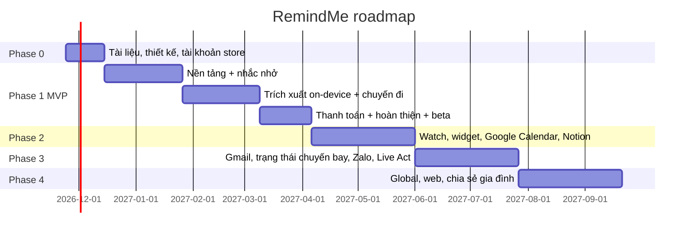

# Kế hoạch triển khai

> TL;DR: 5 phase trong ~9 tháng. Phase 1 (MVP) là sprint 1-8 (16 tuần), launch beta VN tháng 4/2027, trước khi
> Microsoft To Do ngừng app (30/06/2027). Đội tối thiểu: 2 Flutter (1 người kiêm native iOS/Android), 1 backend + "parser/mẫu",
> 1 designer bán thời gian, 1 PM/QA. Đọc file/ảnh chạy trên máy, không dùng AI API trả phí (ADR-010); kế hoạch chi tiết ở mục "Trích xuất on-device".
> Khung quy trình: NEXUS-Sprint của Agency (`docs/guides/ai-dev-workflow.md`). Mỗi phase có quality gate.

## Tổng quan

## Phase 0: Khám phá & nền móng (3 tuần, đang làm)
- [x] Tài liệu hệ thống, UI/UX, nghiên cứu đối thủ, kế hoạch (bộ docs này)
- [ ] Phỏng vấn 10-15 người dùng tiềm năng (5 persona), xác nhận giả thuyết PRD mục 6
- [ ] Prototype Figma (hoặc HTML) cho 6 luồng P0, test với 5 người
- [ ] Đăng ký Apple Developer (tổ chức), Google Play Console, domain, email, Firebase, Supabase (staging/prod)
- [ ] Thu thập ≥ 300 mẫu booking/vé/giấy hẹn ẩn danh (≥ 20 nhà cung cấp) cho eval set và để viết mẫu
- [ ] Spike kỹ thuật OCR (xem mục E0 bên dưới)
- [ ] Khung repo: monorepo, CI (GitHub Actions), lint, format, commit convention
- **Gate:** PRD đã chốt sau phỏng vấn; prototype pass test (≥ 4/5 người hoàn thành tác vụ chính không cần trợ giúp)

## Phase 1: MVP (16 tuần = 8 sprint x 2 tuần)
| Sprint | Mục tiêu | Deliverable chính |
|---|---|---|
| S1 | Bootstrap | Flutter app (flavors staging/prod), theme từ token, go_router, Drift schema, Supabase migrations + RLS + pgTAP, worker skeleton + CI deploy |
| S2 | Todo core | Lists, items CRUD, Hôm nay, chi tiết item, Quick Add (gõ) + `QuickParser` vi/en (fixtures), sync push/pull |
| S3 | Reminder engine | Scheduler rolling window, Android exact alarm + boot/tz receivers, iOS categories/actions, snooze, telemetry, onboarding OEM |
| S4 | Lặp & âm lịch & giọng nói | RRULE UI + engine, âm lịch (thuật toán + test 2020-2050), STT on-device, đa việc trong 1 câu |
| S5 | Trích xuất nền tảng | E1 decoder T0 + E2 OCR plugin + E3 bộ máy luật/extractor chung + eval CI (xem mục Trích xuất on-device) |
| S6 | Mẫu, chuyến đi & email | E4 mẫu top-10 nhà cung cấp + CDN, E5 màn Xem lại, trips + timeline, nhắc mặc định booking, E6 hộp thư email, share extension, Hộp đề xuất |
| S7 | Monetization & import To Do | RevenueCat, paywall, entitlements + quota (client + server), Microsoft To Do importer (Graph), Lịch (tháng/tuần) |
| S8 | Hardening & beta | Auth Apple/Google/email/anonymous, xóa/xuất dữ liệu, accessibility pass, hiệu năng, Sentry/PostHog, store listing, TestFlight + Play closed test |
- **Gate (Reality Checker mặc định "NEEDS WORK" tới khi có bằng chứng):** NFR ở `system-architecture.md` mục 5 đạt trên
  ≥ 6 máy thật (Xiaomi, OPPO, vivo, Samsung, iPhone cũ/mới); eval booking ≥ 95% trường bắt buộc; crash-free ≥ 99,5%; 0 lỗi P0 mở.
- Launch: beta công khai VN (Play open testing + TestFlight public link), rồi production.

## Phase 2: Hệ sinh thái (8 tuần)
Apple Watch app + complication, Wear OS app + Tile, widget iOS/Android (interactive), Google Calendar 2 chiều (sau OAuth verification),
E7 LLM của OS (Foundation Models, Gemini Nano) làm tầng T3, mở rộng mẫu lên 25+ nhà cung cấp,
feed ICS, Notion sync, Google Tasks, import Todoist/TickTick, nhắc kiểu báo thức, nhắc vị trí, Siri/App Intents.

## Phase 3: Thông minh hơn (8 tuần)
Gmail scan chạy trên máy (kiểm tra yêu cầu thẩm định khi không qua server), E8 thử nghiệm model mở tải về (T4) nếu eval cho thấy cần, trạng thái chuyến bay + Live Activities, Zalo ZNS, digest email, gợi ý tự động
("Bạn có 3 việc trùng giờ"), thống kê thói quen.

## Phase 4: Mở rộng
Bản global (en, thanh toán USD, marketing ASO), web app (Flutter web hoặc Next.js) đọc/sửa, chia sẻ chuyến đi/list cho gia đình,
gói Family.

## Trích xuất on-device: kế hoạch chi tiết
Ước lượng theo ngày công (d) của 1 dev, chưa gồm review/QA. Mỗi đầu việc có tiêu chí nghiệm thu (AC) đo được.

### E0. Spike & dữ liệu (Phase 0, ~8d)
| # | Việc | d | AC |
|---|---|---|---|
| E0.1 | App thử (Flutter) chụp/chọn ảnh → OCR ML Kit (Android, iOS) + Vision (iOS), xuất `ocr.json` | 3 | Chạy trên ≥ 4 máy thật (Xiaomi, Samsung, iPhone 12, iPhone 15 Pro) |
| E0.2 | Kiểm tra tiếng Việt: `supportedRecognitionLanguages` của Vision, độ chính xác có dấu trên 50 ảnh | 2 | Bảng so sánh CER (tỷ lệ lỗi ký tự) ML Kit vs Vision; chọn engine mặc định cho iOS |
| E0.3 | Kiểm tra Foundation Models (iOS 26.1+, tiếng Việt) và Gemini Nano Prompt API trên máy có sẵn | 2 | Ghi nhận: có/không, độ trễ, chất lượng trên 20 mẫu |
| E0.4 | Quy trình thu & ẩn danh mẫu: form nhận mẫu, script che dữ liệu, cấu trúc `fixtures/docs/<id>/{input, ocr.android.json, ocr.ios.json, expected.json}` | 1 | ≥ 300 mẫu, ≥ 20 nhà cung cấp, đủ 6 loại tài liệu |

### E1. Decoder T0 (S5, ~7d), `packages/parsers/decoders/`
| # | Việc | d | AC |
|---|---|---|---|
| E1.1 | `.pkpass`, `.ics` (VEVENT/VTODO/RRULE/VALARM) | 1,5 | 20 file mẫu pass |
| E1.2 | MIME (`enough_mail`) + HTML → text sạch + JSON-LD/Microdata schema.org Reservation | 2 | 30 email mẫu (OTA quốc tế + hãng VN) |
| E1.3 | PDF text layer có tọa độ (`pdfrx`) → cùng model `OcrDocument`; phát hiện PDF scan → render ảnh | 1,5 | PDF 20 trang < 3 s trên máy tầm trung |
| E1.4 | Parser IATA BCBP từ barcode (PDF417/Aztec/QR) | 1 | Đúng 100% trên 20 boarding pass mẫu + test vector chuẩn |
| E1.5 | xlsx/csv: header detection, từ điển cột, suy kiểu, serial date | 1 | 15 file mẫu; 5.000 dòng < 3 s |
| (S2) | Markdown/Obsidian Tasks | (đã làm cùng Quick Add) | |

### E2. Plugin OCR native (S5, ~6d)
| # | Việc | d | AC |
|---|---|---|---|
| E2.1 | Interface Dart `OcrEngine` + model `OcrDocument` (blocks/lines/bbox/conf), chạy nền | 1 | Unit test model |
| E2.2 | Android: ML Kit Text v2 (unbundled + fallback bundled), Barcode, Document Scanner | 2 | 1 ảnh < 1,5 s; máy không GMS vẫn chạy |
| E2.3 | iOS: Vision `RecognizeTextRequest`/`RecognizeDocumentsRequest` + VisionKit camera, hoặc ML Kit nếu E0.2 chọn | 2 | Như trên |
| E2.4 | Tiền xử lý ảnh (resize, EXIF), hậu xử lý NFC + chuẩn hóa bỏ dấu cho so khớp | 1 | Fixtures chuẩn hóa |

### E3. Bộ máy luật T2 (S5, ~10d), `packages/parsers/engine/`
| # | Việc | d | AC |
|---|---|---|---|
| E3.1 | Tìm anchor mờ (bỏ dấu, Levenshtein ≤ 1) + lấy vùng phải/dưới theo bbox | 2 | 50 case unit test |
| E3.2 | Extractor chung: ngày/giờ VN-EN, IATA + tz, số chuyến bay, PNR, ghế/toa, mã tàu, tiền, SĐT, địa chỉ | 3 | Mỗi extractor ≥ 30 case |
| E3.3 | Bộ phân loại tài liệu (trọng số JSON) + script huấn luyện trọng số offline từ fixtures | 1,5 | ≥ 95% phân loại đúng trên eval |
| E3.4 | Validator + confidence + kiểm tra logic + dedupe + gom trip | 2 | Không có trường "điền sai" do lỗi logic trên eval |
| E3.5 | Harness eval CI (`dart test` trên `ocr.json`) + báo cáo theo trường/nhà cung cấp | 1,5 | Chạy < 2 phút trên CI, chặn merge khi giảm |

### E4. Mẫu nhà cung cấp (S6 rồi liên tục, ~12d cho 10 mẫu đầu)
| # | Việc | d | AC |
|---|---|---|---|
| E4.1 | Định dạng JSON mẫu + JSON Schema + engine đọc mẫu (anchor, pattern, repeat_block) | 2 | Validate schema trong CI |
| E4.2 | `template_lab`: CLI chạy 1 mẫu trên thư mục fixtures, in diff với expected | 1 | Dev viết mẫu mới < 0,5 ngày |
| E4.3 | 10 mẫu ưu tiên: Vietnam Airlines, Vietjet, Bamboo, Traveloka, Agoda, Booking.com, Đường sắt VN, FUTA, Vexere, Medpro | 7 | Mỗi mẫu ≥ 95% trường bắt buộc đúng trên ≥ 10 mẫu thật |
| E4.4 | Phát hành mẫu: ký Ed25519, `manifest.json` trên CDN, app tải + xác minh + rollback về bản đóng gói | 2 | Mẫu sai chữ ký bị từ chối; cập nhật không cần phát hành app |

### E5. Màn Xem lại & vòng cải thiện (S6, ~7d)
| # | Việc | d | AC |
|---|---|---|---|
| E5.1 | Thẻ candidate, tô vàng trường thấp, evidence, gộp trip, hiển thị quota | 3 | Test với 5 người: sửa 1 trường < 5 s |
| E5.2 | "Nhập tay với ảnh tham chiếu": chạm dòng OCR để điền trường | 2 | Nhập 1 vé lạ < 30 s |
| E5.3 | Nhớ mapping cột xlsx / loại tài liệu theo chữ ký | 1 | Lần import thứ 2 cùng định dạng không phải sửa |
| E5.4 | Telemetry ẩn danh + "Gửi mẫu để cải thiện" (che dữ liệu, xem trước) | 1 | Không có giá trị trường trong payload (test tự động) |

### E6. Hộp thư email (S6, ~4d)
| # | Việc | d | AC |
|---|---|---|---|
| E6.1 | Webhook inbound → kiểm SPF/DKIM, rate limit, kích thước → lưu MIME mã hóa → push `inbox.new` | 2 | 31 email/ngày thì email thứ 31 bị từ chối; quá 50 MB xóa cũ nhất |
| E6.2 | App: tải MIME, chạy pipeline, Hộp đề xuất, `ack` để xóa trên server | 2 | Email tới → đề xuất hiện trên máy < 1 phút khi online |

### E7. LLM của hệ điều hành, T3 (Phase 2, ~8d)
| # | Việc | d | AC |
|---|---|---|---|
| E7.1 | Swift: Foundation Models, `@Generable ExtractionResult`, chia khối theo context, iOS 27 đầu vào ảnh | 3 | Chạy được trên iPhone 15 Pro+, tự tắt trên máy không hỗ trợ |
| E7.2 | Kotlin: ML Kit GenAI Prompt API, JSON + validate, xử lý busy/foreground | 3 | Như trên, trên ≥ 1 máy Android có Gemini Nano |
| E7.3 | Eval T3 trên tài liệu không có mẫu; remote config bật/tắt theo nền tảng | 2 | Chỉ bật nếu tăng ≥ 10 điểm % trường đúng trên tài liệu lạ và điền sai không tăng |

### E8. Model mở tải về, T4 (Phase 3, thử nghiệm, ~10d)
Gemma (bản nhỏ, qua LiteRT-LM/`flutter_gemma`) cho máy RAM ≥ 8 GB không có LLM của OS. Chỉ làm nếu E7.3 cho thấy T3 có ích
và phần lớn người dùng không có T3. Điều kiện: người dùng đồng ý tải model qua Wi-Fi, kiểm tra giấy phép model, đo pin/nhiệt.

**Tổng phần trích xuất cho MVP (E0-E6): ~54 ngày công.** E0 làm ở Phase 0 (8d). E1-E6 (46d) vượt sức chứa của 2 người trong S5-S6 (~40d),
nên người backend/parser bắt đầu E3.2 và E4.3 song song từ S3-S4 (khi đã có fixtures), phần còn lại làm trong S5-S6.

## Checklist tích hợp theo phase
| Phase | Tích hợp | Tài liệu |
|---|---|---|
| 0 | Tài khoản Apple/Google/Firebase/Supabase/domain, nộp OAuth sớm | `integration-guide.md` mục 0 |
| 1 | FCM/APNs, RevenueCat + store, Supabase Auth, share sheet, email forward, Microsoft Graph (To Do), ML Kit / Vision / VisionKit | mục 1-4, 7, 12 |
| 2 | Google Calendar, Notion, Google Tasks, WatchConnectivity, Wear Data Layer, WidgetKit/Glance, Foundation Models, Gemini Nano | mục 5, 7, 8, 9, 12 |
| 3 | Gmail + CASA, flight status API, Zalo ZNS, ActivityKit push | mục 6, 10, 11 |

## Rủi ro kế hoạch
| Rủi ro | Ảnh hưởng | Phương án |
|---|---|---|
| Duyệt OAuth Google kéo dài | Trễ Calendar sync | Nộp từ Phase 1; email forward + ICS thay thế |
| Microsoft công bố ngày tắt API To Do sớm | Mất kênh import | Ưu tiên importer ở S7, có thể kéo lên S5; hỗ trợ file export |
| Đọc kém với vé nội địa VN / bố cục lạ | Trải nghiệm chính hỏng | Eval set ≥ 300 mẫu từ Phase 0; mẫu cho top nhà cung cấp; "nhập tay với ảnh tham chiếu" thật nhanh |
| Khối lượng viết mẫu lớn hơn dự kiến | Trễ S6, chất lượng không đều | Bắt đầu viết mẫu song song từ S3 khi có mẫu thật; dev dùng AI coding assistant để viết mẫu (chi phí cố định, không theo user) |
| Đội nhỏ, watch native tốn công | Trễ Phase 2 | Phase 1 chỉ cần mirror; Wear OS trước nếu đa số người dùng Android |
