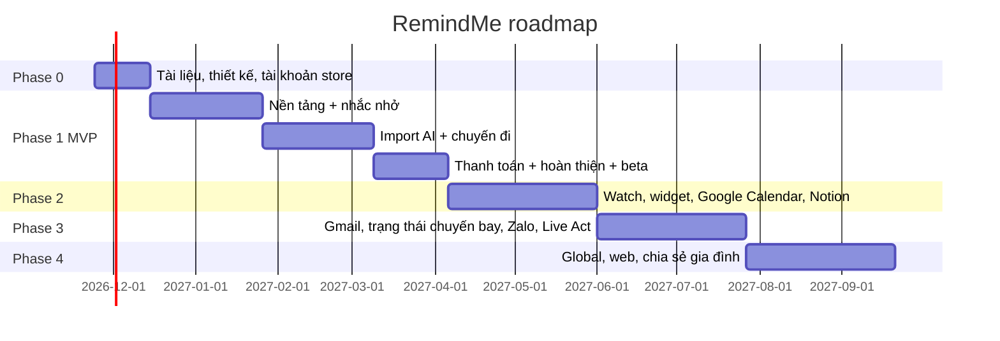

# Kế hoạch triển khai

> TL;DR: 5 phase trong ~9 tháng. Phase 1 (MVP) là sprint 1-8 (16 tuần), launch beta VN tháng 4/2027, trước khi
> Microsoft To Do ngừng app (30/06/2027). Đội tối thiểu: 2 Flutter, 1 backend/AI, 1 designer bán thời gian, 1 PM/QA.
> Khung quy trình: NEXUS-Sprint của Agency (`docs/guides/ai-dev-workflow.md`). Mỗi phase có quality gate.

## Tổng quan

## Phase 0: Khám phá & nền móng (3 tuần, đang làm)
- [x] Tài liệu hệ thống, UI/UX, nghiên cứu đối thủ, kế hoạch (bộ docs này)
- [ ] Phỏng vấn 10-15 người dùng tiềm năng (5 persona), xác nhận giả thuyết PRD mục 6
- [ ] Prototype Figma (hoặc HTML) cho 6 luồng P0, test với 5 người
- [ ] Đăng ký Apple Developer (tổ chức), Google Play Console, domain, email, Firebase, Supabase (staging/prod)
- [ ] Thu thập ≥ 150 mẫu booking/vé/giấy hẹn ẩn danh cho eval set
- [ ] Khung repo: monorepo, CI (GitHub Actions), lint, format, commit convention
- **Gate:** PRD đã chốt sau phỏng vấn; prototype pass test (≥ 4/5 người hoàn thành tác vụ chính không cần trợ giúp)

## Phase 1: MVP (16 tuần = 8 sprint x 2 tuần)
| Sprint | Mục tiêu | Deliverable chính |
|---|---|---|
| S1 | Bootstrap | Flutter app (flavors staging/prod), theme từ token, go_router, Drift schema, Supabase migrations + RLS + pgTAP, worker skeleton + CI deploy |
| S2 | Todo core | Lists, items CRUD, Hôm nay, chi tiết item, Quick Add (gõ) + `QuickParser` vi/en (fixtures), sync push/pull |
| S3 | Reminder engine | Scheduler rolling window, Android exact alarm + boot/tz receivers, iOS categories/actions, snooze, telemetry, onboarding OEM |
| S4 | Lặp & âm lịch & giọng nói | RRULE UI + engine, âm lịch (thuật toán + test 2020-2050), STT on-device, đa việc trong 1 câu |
| S5 | Import pipeline | `/v1/imports`, Storage, pg-boss, tiền xử lý (pdf text, xlsx, md, ics, pkpass, BCBP barcode), Claude extraction + schema + eval CI |
| S6 | Chuyến đi & email | Màn Xem lại, trips + timeline, nhắc mặc định booking, email inbound (`in.remindme.app`), share extension iOS/Android, Hộp đề xuất |
| S7 | Monetization & import To Do | RevenueCat, paywall, entitlements + quota (client + server), Microsoft To Do importer (Graph), Lịch (tháng/tuần) |
| S8 | Hardening & beta | Auth Apple/Google/email/anonymous, xóa/xuất dữ liệu, accessibility pass, hiệu năng, Sentry/PostHog, store listing, TestFlight + Play closed test |
- **Gate (Reality Checker mặc định "NEEDS WORK" tới khi có bằng chứng):** NFR ở `system-architecture.md` mục 5 đạt trên
  ≥ 6 máy thật (Xiaomi, OPPO, vivo, Samsung, iPhone cũ/mới); eval booking ≥ 95% trường bắt buộc; crash-free ≥ 99,5%; 0 lỗi P0 mở.
- Launch: beta công khai VN (Play open testing + TestFlight public link), rồi production.

## Phase 2: Hệ sinh thái (8 tuần)
Apple Watch app + complication, Wear OS app + Tile, widget iOS/Android (interactive), Google Calendar 2 chiều (sau OAuth verification),
feed ICS, Notion sync, Google Tasks, import Todoist/TickTick, nhắc kiểu báo thức, nhắc vị trí, Siri/App Intents.

## Phase 3: Thông minh hơn (8 tuần)
Gmail scan (nếu CASA xứng đáng), trạng thái chuyến bay + Live Activities, Zalo ZNS, digest email, gợi ý tự động
("Bạn có 3 việc trùng giờ"), thống kê thói quen.

## Phase 4: Mở rộng
Bản global (en, thanh toán USD, marketing ASO), web app (Flutter web hoặc Next.js) đọc/sửa, chia sẻ chuyến đi/list cho gia đình,
gói Family.

## Checklist tích hợp theo phase
| Phase | Tích hợp | Tài liệu |
|---|---|---|
| 0 | Tài khoản Apple/Google/Firebase/Supabase/domain, nộp OAuth sớm | `integration-guide.md` mục 0 |
| 1 | FCM/APNs, RevenueCat + store, Supabase Auth, share sheet, email forward, Microsoft Graph (To Do), Claude API | mục 1-4, 7 |
| 2 | Google Calendar, Notion, Google Tasks, WatchConnectivity, Wear Data Layer, WidgetKit/Glance | mục 5, 7, 8, 9 |
| 3 | Gmail + CASA, flight status API, Zalo ZNS, ActivityKit push | mục 6, 10, 11 |

## Rủi ro kế hoạch
| Rủi ro | Ảnh hưởng | Phương án |
|---|---|---|
| Duyệt OAuth Google kéo dài | Trễ Calendar sync | Nộp từ Phase 1; email forward + ICS thay thế |
| Microsoft công bố ngày tắt API To Do sớm | Mất kênh import | Ưu tiên importer ở S7, có thể kéo lên S5; hỗ trợ file export |
| AI kém với vé nội địa VN | Trải nghiệm chính hỏng | Eval set đa dạng từ Phase 0; luồng sửa tay tốt |
| Đội nhỏ, watch native tốn công | Trễ Phase 2 | Phase 1 chỉ cần mirror; Wear OS trước nếu đa số người dùng Android |
